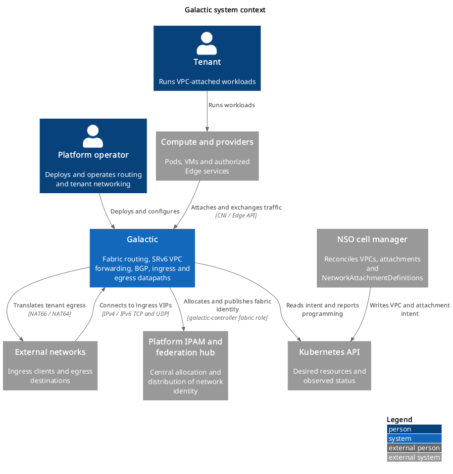
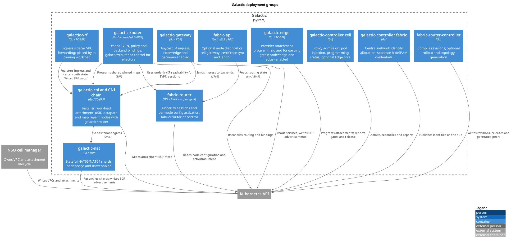

# System diagrams

These diagrams show system boundaries and deployment groups. A box may contain several related commands; this is not a count of binaries or a claim that every node runs every component.

## System context

NSO owns VPC and attachment lifecycle. Galactic's cell controller handles policy, pod injection and programming status, while its separate fabric role allocates central network identity. The [controller reference](../controller/README.md) defines these responsibilities.



## Deployment groups

Gateway, NAT and Edge agents have independent opt-in labels on edge nodes. Tenant router and CNI placement is independent of those opt-ins. Fabric routing and diagnostics have their own deployment prerequisites. See [node labels](../operations/node-labels.md) and each component's deployment guide.

The gateway and NAT share an XDP hook only when configured to use the dispatcher. The router uses the underlay to carry EVPN sessions; it does not establish the underlay's FRR sessions itself.



## Updating the diagrams

The checked-in PNGs were rendered with PlantUML 1.2026.9, its bundled C4 library, and the Smetana layout engine on Java 21. Edit [context.puml](context.puml) or [containers.puml](containers.puml), then regenerate both PNGs from that version. The sources use PlantUML's bundled C4 library so they do not fetch a moving remote include.

From the repository root, with a PlantUML installation:

```sh
plantuml -Playout=smetana -tpng docs/architecture/context.puml docs/architecture/containers.puml
```

With a container runtime, use the PlantUML image selected by your development environment, mount this directory at `/data`, and render the two sources there. Record the renderer version when changing generated assets. Commit sources and rendered files together.

## Component explanations

- [CNI attachment and uSID datapath](../cni/architecture.md)
- [Tenant BGP router](../router/architecture.md)
- [Ingress gateway](../gateway/architecture.md)
- [Active/active egress](../nat/active-active.md)
- [Fabric routing](../fabric-routing/topology.md)
- [Fabric diagnostics](../fabric-api/architecture.md)
