# GC Sequence Diagrams

Two sequence diagrams for Galactic's garbage collection: the orphaned
`BGPAdvertisement`/`BGPVRFInstance` CRD and kernel-VRF sweep that
`galactic-router`'s `GCReconciler` runs on a ticker, and the eBPF `vrf_table`
sweep that `galactic-cni`'s `run` container runs on its own, independent
ticker. Both diagrams use plain Mermaid `sequenceDiagram` syntax, which
GitHub and Obsidian both render natively from a ```` ```mermaid ```` fence —
no plugin or preprocessing required in either viewer.

## Why GC exists

Every CNI-chain binary's own `cmdDel` is intentionally minimal — see
[docs/cni/cni-cmd-sequence.md](cni-cmd-sequence.md#notes-on-del). The VRF,
VRF-table routes, the eBPF `vrf_table` entry, and the `BGPVRFInstance`/
`BGPAdvertisement` CRDs are all keyed by `(vpc, vpcAttachment)` or
`(vpc, node)`, not by `containerID`, so no per-container DEL call is ever
allowed to delete them outright: another pod/VM on the same attachment might
still depend on them, and deleting them synchronously would race a
concurrent ADD during a pod restart. That leaves a gap — a force-terminated
container (kubelet SIGKILL, node crash, netns torn down without CNI DEL ever
running) leaves this shared state behind with nothing left alive to
eventually clean it up on DEL. GC exists to close that gap asynchronously,
on a periodic sweep, by checking actual liveness on the node rather than
trusting that DEL always fires.

The per-attachment host veth/tap interface itself is **not** part of that
list. It is private to one attachment, so `cmdDel` deletes it directly and
immediately (`veth.Delete`/`tap.Delete`) rather than deferring it here — see
[docs/cni/cni-cmd-sequence.md](cni-cmd-sequence.md#notes-on-del) for why that
is safe. It used to be deferred the same way as the VRF, which was a real
leak: GC's own kernel sweep below only ever recognizes VRF-shaped interface
names, so a host interface deferred to GC was never actually reclaimed by
anything, and was left behind enslaved to a VRF that no longer existed once
GC collected it.

The one exception is a host link whose DEL never removed it. A veth dies with
its pod's netns, but a host-namespace tap (the Kata DAN and Unikraft path)
survives its sandbox, stays enslaved to the VPC's VRF and keeps its
pod-subnet route. When the control plane later gives that address to another
attachment, the new attachment's route is refused as a conflict on every
retry. So when GC reaps a dead attachment's `BGPAdvertisement`, it first
removes that attachment's host link (`reclaimHostLinks`,
`internal/gc/hostlinks.go`), and the kernel removes the link's routes with it.
It removes only a link on the advertisement's VPC whose owner alias is one of
the containers the advertisement recorded, all of which GC has just found
gone, or an unstamped link whose name maps to the advertisement exactly. It
decides again under the VRF lock, so a link a new container adopted since is
kept. A link it cannot remove keeps the advertisement for the next pass,
because once the advertisement is gone nothing on the node can prove the link
dead. A link that leaked before this reclaim existed has no record left and
is never touched.

Both sweeps below are conceptually "GC" and live in the same `internal/gc`
package, but run as two unrelated ticker loops in two different processes,
each reading only the liveness signal it can see for itself:

| Sweep                                   | Process                            | Reads                                                                               | Removes                                                                                 |
| --------------------------------------- | ---------------------------------- | ----------------------------------------------------------------------------------- | --------------------------------------------------------------------------------------- |
| Orphaned CRD + kernel VRF sweep         | `galactic-router` (`GCReconciler`) | `/var/run/netns` on this node, `BGPRouter`/`BGPAdvertisement`/`BGPVRFInstance` CRDs | `BGPAdvertisement`, `BGPVRFInstance` CRDs; a dead attachment's host link; kernel VRFs   |
| eBPF `vrf_table` sweep                  | `galactic-cni`'s `run` container   | the pinned eBPF `vrf_table` map, `BGPRouter`/`BGPVRFInstance` CRDs                  | stale `vrf_table` map entries (`Block`, `Argument` keys)                                |

The loops have different ownership and liveness inputs. The installer loads and
repairs the uSID maps and sweeps their stale VRF entries; the router reclaims
orphaned CRDs and kernel VRFs. Both processes now mount `/sys/fs/bpf` and the
router has `CAP_BPF` for its binding and traffic-policy work. The split is not
an isolation boundary based on the router lacking BPF access.

---

## GC — orphaned CRD and kernel VRF sweep (galactic-router)

```mermaid
sequenceDiagram
    autonumber
    participant Ticker as GC ticker (Interval, default 5m)
    participant GCR as GCReconciler
    participant GC as gc.RunGC
    participant K8s
    participant Netns as /var/run/netns
    participant Kernel as kernel VRF interfaces
    participant Edge as maintenance.Guard<br/>(edge write fence)

    Note over Ticker,GCR: On startup, root.go waits for the manager's<br/>informer cache to sync, then runs one pass<br/>immediately before the ticker's first tick

    Ticker->>GCR: tick
    activate GCR
    GCR->>GC: RunGC(ctx, k8s, namespace, nodeName, edge)
    activate GC

    Note over GC: Phase 1 — orphaned CRDs
    GC->>K8s: List BGPRouters in namespace
    GC->>GC: routerNames = routers whose TargetRef.Name == nodeName
    GC->>K8s: List BGPAdvertisements in namespace

    loop each BGPAdvertisement owned by one of routerNames
        GC->>GC: vpc = vpcFromName(adv.Name)
        GC->>GC: collect netns paths from adv's galactic.datum.net/netns.* annotations
        alt no netns annotations recorded
            GC->>GC: mark vpc as surviving (liveness undeterminable, never guess orphaned)
        else at least one recorded
            loop each recorded netns path
                GC->>Netns: stat(netns path)
            end
            alt any recorded netns still exists
                GC->>GC: mark vpc as surviving
            else none exist
                GC->>GC: record BGPAdvertisement as orphaned
            end
        end
    end

    GC->>Edge: VPCs() — VPCs edge attachments use on this node
    alt edge use unknown
        GC->>GC: record no BGPVRFInstance this pass
    else known
        GC->>K8s: List BGPVRFInstances in namespace
        GC->>Kernel: list VRF interfaces and the links enslaved to them
        loop each BGPVRFInstance owned by one of routerNames
            alt no surviving BGPAdvertisement, no edge attachment and no enslaved link for this VPC
                GC->>GC: record BGPVRFInstance as orphaned
            end
        end
    end

    loop each orphaned CRD
        alt BGPAdvertisement
            GC->>Kernel: under the VRF lock, delete the attachment's host link still owned by a recorded dead container
            GC->>K8s: Delete, only if no such link remains (best-effort — errors logged, sweep continues)
        else BGPVRFInstance whose VRF is gone
            GC->>Kernel: under the VRF lock, look for its VRF again
            GC->>K8s: Delete, only if its VRF is still absent or holds no link
        else BGPVRFInstance
            GC->>Edge: Reclaim(vpc of its VRF) — under the VPC's fence, check edge use again
            Edge->>Kernel: under the VRF lock, check the VRF holds no link
            Edge->>K8s: Delete, only if neither an edge attachment nor a link uses the VPC
        end
    end

    Note over GC: Phase 2 — orphaned kernel VRFs
    GC->>Kernel: list VRF interfaces on this node
    GC->>K8s: List BGPRouters, then BGPAdvertisements again (post-deletion)
    GC->>GC: activeVPCs = VPCs with a surviving BGPAdvertisement owned by this node
    GC->>Edge: VPCs() — added to activeVPCs; unknown skips Phase 2

    loop each kernel VRF interface
        GC->>GC: resolve VPC from interface name<br/>(current "G{vpc}V" shape or legacy "G{vpc}{att}V" shape)
        alt interface name doesn't match either Galactic shape
            GC->>GC: skip, not ours
        else VPC in activeVPCs
            GC->>GC: keep
        else a link is enslaved to the VRF
            GC->>GC: keep, logged
        else
            GC->>GC: record VRF as orphaned
        end
    end

    loop each orphaned VRF
        GC->>Edge: Reclaim(vpc) — under the VPC's fence, check edge use again
        alt an edge attachment uses the VPC
            Edge-->>GC: ErrInUse, VRF kept
        else
            Edge->>Kernel: vrf.DeleteIfUnused(name) — under the VRF lock, delete the interface observed unless a link is enslaved to it
        end
    end

    GC->>GC: log summary (CRDs removed, VRFs removed, errors)
    GC-->>GCR: CleanupResult
    deactivate GC
    GCR-->>Ticker: ctrl.Result{RequeueAfter: Interval}
    deactivate GCR
```

### Notes

- **Liveness is read from the node, not inferred from CRD age.** GC never
  times a CRD out — it checks whether the exact `netns` path recorded on a
  `BGPAdvertisement` at CNI ADD time (`galactic.datum.net/netns.<containerID>`
  annotation) still exists under `/var/run/netns` on this node right now.
  That path can't be reconstructed from a container ID alone (the container
  runtime's own bind-mount naming convention has no relationship to it), so
  the exact value recorded at ADD time is what gets checked.
- **A `BGPAdvertisement` can carry several netns annotations at once.** Pod
  churn on the same `(vpc, vpcAttachment)` adds a new annotation entry
  without removing old ones — `cmdDel` never touches this shared CRD. The
  object is only orphaned once **every** container that ever referenced it is
  confirmed gone, not just the most recent one.
- **A dead sibling's annotations don't have to wait for this sweep.** This
  whole-object collection only fires once every container that ever
  referenced the `BGPAdvertisement` is dead, which is never true while the
  attachment still has any live pod — the ordinary case for a
  Deployment-style replacement. `galactic-bgp`'s own ADD path now prunes a
  dead sibling's netns and subnet annotations directly
  (`pruneDeadContainerAnnotations`, using the same `NetNSExists` liveness
  check this sweep uses) the moment a new container attaches, so that class
  of staleness self-heals on the very next ADD and never depends on this
  ticker at all. See
  [docs/cni/cni-cmd-sequence.md](cni-cmd-sequence.md#notes-on-add). This
  sweep still owns the case pruning cannot reach: reclaiming the entire CRD
  once no container ever attaches again.
- **No netns annotations at all means "assume alive," never "assume
  orphaned."** A `BGPAdvertisement` GC can't judge — no annotations recorded,
  possibly a legacy or manually-created object — counts as surviving. GC's
  guiding rule throughout is to never guess a shared resource is safe to
  reclaim.
- **`BGPVRFInstance` is judged at VPC granularity, `BGPAdvertisement` at
  vpc+attachment granularity.** The VRF (and its `BGPVRFInstance` CRD) is
  shared by every attachment on a VPC on this node, so it's orphaned only
  once every `BGPAdvertisement` whose name starts with that VPC segment is
  either orphaned or entirely absent — not by aliasing off one specific
  `BGPAdvertisement`'s name.
- **Phase 2 re-lists `BGPAdvertisement`s after Phase 1's deletions.** This
  means a CRD deleted moments earlier in the same pass can already be
  reflected in Phase 2's `activeVPCs` set (subject to the informer cache
  catching up), letting a VPC's kernel VRF be reclaimed in the very same GC
  pass its last CRD was. If the cache hasn't caught up yet, nothing is lost —
  the next tick simply repeats the whole pass, and GC's outputs are
  idempotent either way.
- **The kernel-VRF sweep understands two interface-name shapes.** The
  current template (`G{9-char-vpc}V`) is per-VPC; a legacy pre-rename
  template (`G{9-char-vpc}{3-char-att}V`) carried a VPCAttachment segment
  the same way host/guest veth names still do. A node upgraded in place can
  still be running interfaces named the old way, and both resolve to the
  same VPC for liveness purposes. Either is deleted by the exact interface
  name observed, since rebuilding the *current* name from a legacy
  interface's VPC would silently no-op against it.
- **The kernel overrides the objects for a VRF that holds a link.** A VPC's
  first ADD creates the VRF and enslaves its host link before `galactic-bgp`
  writes the `BGPVRFInstance` and `BGPAdvertisement`, and the informer cache
  can lag behind both. GC therefore keeps the VRF, and the `BGPVRFInstance`
  with its SID Argument, of any VPC whose VRF still has a link enslaved to
  it. The CNI creates or reuses the VRF and enslaves the host link under the
  node's VRF lock (`vrf.EnsureAndEnslave`), and GC re-checks for enslaved
  links under that same lock before deleting either, so no GC pass can find
  the VRF between its creation and its first link. A leaked host link keeps
  its VRF alive; that is the fail-safe direction, and GC logs it. The guard
  needs both sides: a router with this check against a CNI that still
  enslaves outside the lock leaves the original window open, so roll out
  `galactic-cni` and `galactic-router` together.
- **This sweep never matches a per-attachment host veth/tap interface, by
  design.** Both the current and legacy name shapes above end in the VRF
  suffix (`V`); the host interface's own suffix (`H`) never matches either
  regex. `cmdDel` deletes that interface directly, see
  [docs/cni/cni-cmd-sequence.md](cni-cmd-sequence.md#notes-on-del); its only
  GC path is the dead-advertisement reclaim described in
  [Why GC exists](#why-gc-exists).
- **Node scoping matters because CRDs are namespace-, not node-, scoped.**
  `BGPAdvertisement`/`BGPVRFInstance` objects in a namespace can belong to
  routers on other nodes (e.g. the default and rr roles watching
  the same namespace). Every collection pass first filters to only the
  `BGPRouter`s whose `TargetRef.Name` matches this node, and this node's own
  kernel/filesystem state can only ever confirm or deny liveness for
  containers that actually ran here — so a CRD belonging to another node's
  router is never touched, regardless of what this node's kernel looks like.
- **Deletion is best-effort throughout.** A failed `Delete` call (CRD or
  kernel interface) is logged and counted in `CleanupResult.Errors`, but
  never aborts the rest of the sweep — one stuck resource doesn't block
  reclaiming everything else found orphaned in the same pass. The next tick
  tries the failed one again.
- **Edge attachments keep their VPC's VRF and `BGPVRFInstance`.** A Galactic
  Edge attachment joins its VPC's canonical host VRF and writes no
  `BGPAdvertisement`, so `maintenance.Guard` (`internal/edge/maintenance`)
  counts a VPC as used while an `EdgeAttachment` on this node is not
  `Released`, read uncached, or a host link stamped
  `galactic-edge:hostattach:` for it remains. Each delete runs inside
  `Reclaim`, which takes the VPC's write fence (`internal/edge/ownership`,
  `/var/lib/galactic-edge/ownership`) that `galactic-edge` holds while it
  programs, checks again and deletes only if nothing uses the VPC. An
  attachment admitted after collection therefore keeps the VRF, and a change
  `galactic-edge` prepared before the delete is refused and prepared again.
  If the guard cannot answer, because the fence directory is not mounted,
  `edgeattachments` cannot be listed or the links cannot be read, GC deletes
  no VRF or `BGPVRFInstance` that pass and counts an error.
- **The very first pass waits for the cache to sync.** `root.go` calls
  `mgr.GetCache().WaitForCacheSync(ctx)` before the initial `RunGC` — an
  empty, not-yet-populated `BGPAdvertisement`/`BGPRouter` list would
  otherwise look identical to "everything is orphaned" and delete every live
  VRF on the node on startup.

---

## GC — eBPF `vrf_table` sweep (galactic-cni)

```mermaid
sequenceDiagram
    autonumber
    participant Ticker as eBPF GC sweep ticker<br/>(ebpfGCSweepInterval, default 5m)
    participant Run as galactic-cni run container
    participant Sweep as gc.SweepEBPFVRFTable
    participant Map as pinned vrf_table map
    participant K8s

    Ticker->>Run: tick
    activate Run
    alt k8s client not yet set up (eBPF datapath not running)
        Run->>Run: skip this tick, do nothing
    else eBPF datapath running
        Run->>Sweep: SweepEBPFVRFTable(ctx, k8s, namespace, nodeName, pinDir)
        activate Sweep

        Sweep->>Sweep: stat(pinDir)
        alt pin directory missing or inaccessible
            Sweep-->>Run: nothing to do this tick, not an error
        else pin directory present
            Sweep->>Map: OpenPinnedRegistry(pinDir)
            Sweep->>Map: cutoff = reg.VRF.Generation()
            Note over Sweep,Map: cutoff is captured before the CRD list below,<br/>so a registration racing in during this sweep<br/>(a concurrent CNI ADD) is stamped newer<br/>and survives reconciliation

            Sweep->>K8s: routersForNode(nodeName) -> BGPRouters targeting this node
            alt no BGPRouter found for this node
                Sweep-->>Run: skip entirely this tick
                Note over Sweep: a node with any live eBPF-registered attachment<br/>always has a BGPRouter targeting it — finding none<br/>means a transient listing hiccup, not zero live<br/>attachments. Folding that into "nothing is live"<br/>would wipe every entry, every pod, on one bad tick
            else at least one BGPRouter found
                Sweep->>K8s: List BGPVRFInstances in namespace

                loop each BGPVRFInstance owned by one of this node's routers
                    alt router has no srv6Locator, or it fails to parse
                        Sweep->>Sweep: skip — not eBPF-relevant, or misconfigured
                    else VRFID out of the valid Argument range
                        Sweep->>Sweep: skip — do not trust an out-of-range CRD value
                    else
                        Sweep->>Sweep: block = uformat.Block(router's srv6Locator)
                        Sweep->>Sweep: live[{block, VRFID}] = present
                    end
                end

                Sweep->>Map: reg.VRF.Reconcile(live, cutoff)
                Map->>Map: remove every entry not in live whose<br/>generation stamp is older than cutoff
                Map-->>Sweep: removed entries
                Sweep->>Sweep: log each removed entry
            end
        end

        Sweep-->>Run: CleanupResult (EBPFVRFEntriesRemoved, Errors)
        deactivate Sweep
    end
    deactivate Run
```



### Notes

- **Missing rows are rebuilt alongside.** The same tick starts
  `RepairAttachmentDatapath` (`internal/gc/datapath_repair.go`) off the main
  loop, which writes back every row CNI ADD wrote that a recreated map has
  lost, from kernel state and the CRDs. It also runs when the datapath loads.
  The two need no ordering: this sweep reaps only keys no live
  `BGPVRFInstance` names, and the repair writes keys for live ones only.
- **This is a reconcile against a generation cutoff, not a two-list diff.**
  `Generation()` is captured *before* `BGPVRFInstance`s are listed. A CNI ADD
  that registers a brand-new entry (`registerEBPFDatapath`, see
  [docs/cni-cmd-sequence.md](cni-cmd-sequence.md#notes-on-add)) between that
  capture and the CRD list below stamps its entry with a generation newer
  than `cutoff`, so `Reconcile` never removes it even though it won't appear
  in the `BGPVRFInstance` list this sweep happened to see. Without that
  ordering, a CNI ADD racing a GC sweep could have its brand-new eBPF
  registration deleted moments after being created.
- **Finding zero `BGPRouter`s is treated as "can't tell," not "genuinely
  empty."** `registerEBPFDatapath` requires a `BGPRouter` targeting the node
  to run at all, so any node with a live eBPF-registered attachment
  necessarily has one. An empty result here is far more likely a transient
  cache/listing hiccup (or the router object mid-rename) than truly zero
  attachments — and treating it as the latter would wipe the *entire*
  `vrf_table`, every pod on the node, on one bad tick. The sweep skips
  entirely and lets the next tick retry once listing is reliable again.
- **Missing/inaccessible pin directory is normal, not an error.** The eBPF
  datapath's "run" container may not have finished loading and pinning the
  map yet, or `/sys/fs/bpf` may be in a restrictive mode this process can't
  stat. Either way, `SweepEBPFVRFTable` returns cleanly with nothing done —
  it isn't this function's job to diagnose why the pin isn't there yet.
- **Edge attachment links keep their entry.** A Galactic Edge host link
  reuses its VPC's entry (`attachreg.RegisterHostLink`) and has no
  `BGPVRFInstance` of its own, so every entry a link stamped
  `galactic-edge:hostattach:` resolves to through its `ifindex_vrf_table` row
  is live. A sweep that cannot list those links removes nothing that tick.
- **CRD field validation happens inline, per instance.** A `BGPVRFInstance`
  whose router has no `srv6Locator` (not eBPF-relevant at all), an
  unparseable locator, or a `VRFID` outside the valid Argument range is
  skipped individually with a warning — one malformed CRD doesn't abort the
  sweep for every other live entry.
- **Independent ticker, independent process, same default interval by
  design.** `ebpfGCSweepInterval` defaults to 5 minutes specifically to match
  `galactic-router`'s own `GCReconciler` interval — a deliberate parity
  choice, not a shared clock; the two loops never coordinate and can drift
  out of phase with each other freely.
- **This sweep never touches `BGPAdvertisement`/`BGPVRFInstance` CRDs or
  kernel VRF interfaces.** It reconciles exactly one thing: pinned eBPF
  `vrf_table` map entries. Reclaiming the CRDs and kernel VRFs those entries
  ultimately derive from is entirely the other diagram's job, running in a
  different process on its own schedule.
