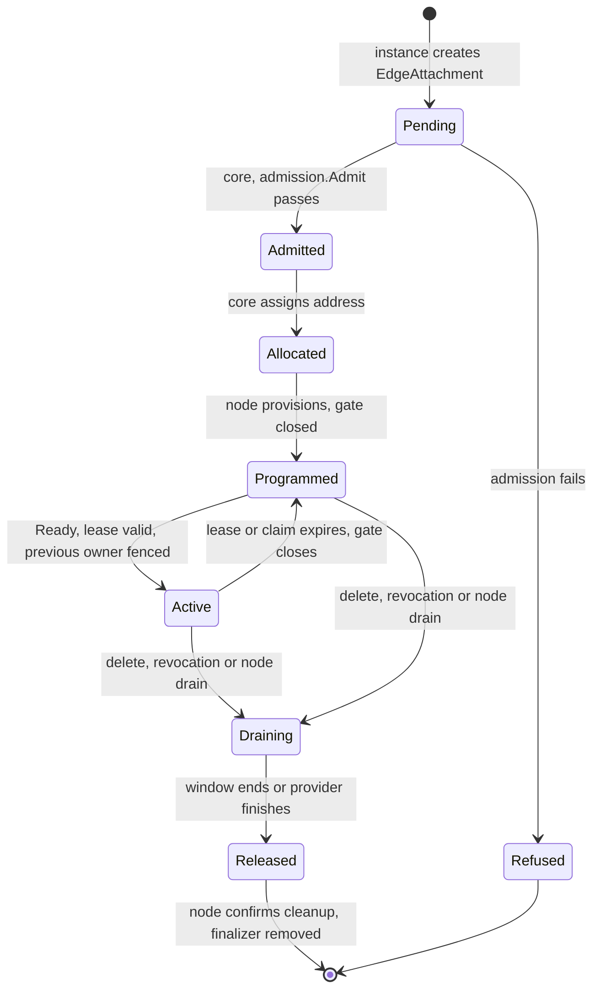
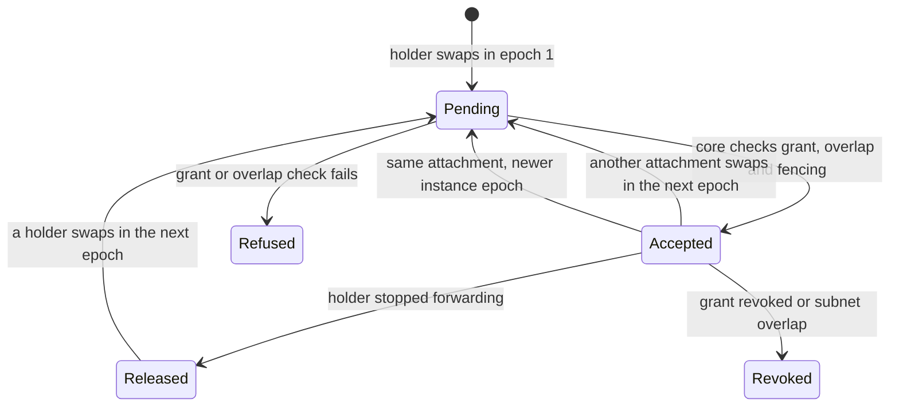

# Galactic Edge provider contract

Status: implementation contract. The core and node implementations consume these resources and lifecycle rules. The failure-test matrix specifies required evidence, not a claim that every environment has passed. See [open qualification items](#open-items) before relying on timing or capacity targets.

Tracking issue: [Define the internal provider contract (#993)](https://github.com/datum-cloud/galactic/issues/993), part of [#992](https://github.com/datum-cloud/galactic/issues/992).

This document is the contract the [Galactic Edge foundation](../designs/galactic-edge.md) is built to. It fixes the resources, writers, state transitions, timing bounds and acceptance tests that the implementation milestones (#994 to #1002) follow. Where it names existing code, it describes that code; where it names a resource or process that does not exist yet, it is a decision, not a description.

- [Decisions](#decisions)
- [Resources](#resources)
- [Provider interface](#provider-interface)
- [Lifecycle](#lifecycle)
- [Timing and failure bounds](#timing-and-failure-bounds)
- [Foundation resources and their writers](#foundation-resources-and-their-writers)
- [Failure-test matrix](#failure-test-matrix)
- [Open items](#open-items)

## Decisions

| Area                    | Decision                                                                                                                                                                                                                                                                                                                                                                                                                                                                                                                                                                  |
| ----------------------- | ------------------------------------------------------------------------------------------------------------------------------------------------------------------------------------------------------------------------------------------------------------------------------------------------------------------------------------------------------------------------------------------------------------------------------------------------------------------------------------------------------------------------------------------------------------------------- |
| Contract representation | Kubernetes resources in `galactic.datumapis.com/v1alpha1`. A provider talks only to the cell's API server; there is no provider RPC.                                                                                                                                                                                                                                                                                                                                                                                                                                      |
| Contract version        | `v1alpha1`. Capabilities are versioned separately: `SocketAccess/v1`, `PacketAccess/v1`, `PrefixReachability/v1`.                                                                                                                                                                                                                                                                                                                                                                                                                                                         |
| Provider authority      | The API server's authentication of the provider pod's bound ServiceAccount token, checked by a ValidatingAdmissionPolicy (see [Admission policy](#admission-policy)). A pod-UID field a provider writes is only checked against the token, never trusted on its own.                                                                                                                                                                                                                                                                                                      |
| Control packaging       | Admission, allocation and publication run in `galactic-controller --role=cell`, leader-elected, one writer per cell.                                                                                                                                                                                                                                                                                                                                                                                                                                                      |
| Node packaging          | A new `galactic-edge` DaemonSet on nodes labeled `galactic.datumapis.com/node=edge` and `galactic.datumapis.com/edge=enabled`. The `edge=enabled` label is new, and [node labels](../operations/node-labels.md) gains it when the DaemonSet ships. `galactic-edge` is the only process that changes host state for an edge attachment. It writes only the CNI datapath's maps under `/sys/fs/bpf/galactic`, and never opens `/sys/fs/bpf/galactic-edge`, which is `galactic-gateway`'s pin directory despite the name (`internal/plumbing/ebpf/edgeattach/attach.go:38`). |
| Provider privilege      | None on the host. A provider pod gets no host namespace, hostPath, `NET_ADMIN` or BPF access. It opens the packet device the node agent created in its own network namespace.                                                                                                                                                                                                                                                                                                                                                                                             |
| Claim store             | The cell's API server, compare-and-swap on `resourceVersion` with a UID precondition, as `internal/edge/claim` requires. Claims never span cells.                                                                                                                                                                                                                                                                                                                                                                                                                         |
| Node-local write fence  | `internal/edge/ownership`, with its state and lock files in the hostPath `/var/lib/galactic-edge/ownership`, shared by every process that writes a fenced scope on the node.                                                                                                                                                                                                                                                                                                                                                                                              |
| Forwarding gate         | A new map of the CNI datapath, with one row per edge host link and per accepted prefix holding a `CLOCK_BOOTTIME` deadline. The datapath compares it with `bpf_ktime_get_boot_ns` on every packet, the pattern `serviceroutemap` already uses for authorization deadlines.                                                                                                                                                                                                                                                                                                |
| Allocation              | Attachment addresses come from the service's client pool, allocated by the leader of `galactic-controller`. Delegated client prefixes are routes the provider requests inside that pool; the prefix conflict check makes them exclusive. No new host table or uSID Argument is allocated: an edge attachment joins the VPC's canonical host VRF.                                                                                                                                                                                                                          |

## Resources

All resources are in `galactic.datumapis.com/v1alpha1`. Object names that carry identity are derived, so a retried create lands on the same object.

| Kind             | Scope     | Name                                | Purpose                                                                     |
| ---------------- | --------- | ----------------------------------- | --------------------------------------------------------------------------- |
| `EdgeProvider`   | Cluster   | Operator's choice                   | Registration: contract and capability versions, ServiceAccounts, privilege. |
| `EdgeService`    | Namespace | Platform authority's choice         | Grant: one provider, one gVPC, prefixes, client pool, validity.             |
| `EdgeInstance`   | Namespace | `ei-` + pod UID                     | One running provider process.                                               |
| `Lease`          | Namespace | The instance's name                 | The instance's liveness lease, a `coordination.k8s.io/v1` Lease it owns.    |
| `EdgeAttachment` | Namespace | `ea-` + pod UID + `-` + service UID | One instance's isolated connection to the service's gVPC.                   |
| `EdgeRoute`      | Namespace | `hash(gVPC UID, prefix)`            | One prefix's forwarding claim and publication.                              |
| `EdgeRouteIndex` | Namespace | gVPC UID                            | Core's record of every accepted route in one gVPC; serializes acceptance.   |

`EdgeInstance`, its `Lease`, `EdgeAttachment` and `EdgeRoute` live in the provider's namespace. `EdgeService` and `EdgeRouteIndex` live in the namespace of the gVPC they reference.

Core finds a route by its spec, never by its name. A route's name only has to be the same in every instance of one provider, so that they contend for a prefix through one object; the hash is the provider's choice.

### Fields and writers

A field not listed is read-only to everyone but the control plane that owns the resource. "Core" is `galactic-controller --role=cell`; "node" is `galactic-edge` on the attachment's node.

| Resource and field                                                                                                                                                                                             | Writer                                                                | Rule                                                                                                                                                                                                                                                                                                                                                                             |
| -------------------------------------------------------------------------------------------------------------------------------------------------------------------------------------------------------------- | --------------------------------------------------------------------- | -------------------------------------------------------------------------------------------------------------------------------------------------------------------------------------------------------------------------------------------------------------------------------------------------------------------------------------------------------------------------------- |
| `EdgeProvider.spec`                                                                                                                                                                                            | Operator                                                              | Contract versions, capabilities, ServiceAccounts, configuration kind.                                                                                                                                                                                                                                                                                                            |
| `EdgeProvider.status.approved`                                                                                                                                                                                 | Operator approval role                                                | No provider ServiceAccount holds `edgeproviders/status`.                                                                                                                                                                                                                                                                                                                         |
| `EdgeService.spec`                                                                                                                                                                                             | Platform authority                                                    | `providerRef`, `vpcRef.uid` and capabilities are immutable. `trafficPolicy` selects the policy of every attachment the service admits (see [Traffic policy](#traffic-policy)).                                                                                                                                                                                                   |
| `EdgeService.status`                                                                                                                                                                                           | Core                                                                  | `Admitted` and `TrafficPolicyResolved` conditions, and `allocations`: each held client-pool address and its attachment, written with a `resourceVersion` precondition.                                                                                                                                                                                                           |
| `EdgeInstance.spec` (`providerRef`, `podName`, `podUID`, `nodeName`, `bootID`)                                                                                                                                 | The instance, at create                                               | Immutable. Must match the token's pod UID and the pod's node.                                                                                                                                                                                                                                                                                                                    |
| The instance's `Lease` (`spec.holderIdentity`, `spec.leaseTransitions`, the `edge-renew-start`, `edge-sequence` and `edge-released` annotations)                                                               | The instance; core to fence it                                        | Compare-and-swap on `resourceVersion` with a UID precondition (`internal/edge/provider`). Its provider label, pod annotation and owner never change, `leaseTransitions` never decreases, and a release holds until a new epoch: the `galactic-edge-lease` policy enforces these for every writer, and the provider policy limits a pod to its own lease. No provider deletes it. |
| `EdgeAttachment.spec` (`providerRef`, `serviceRef`, `instanceRef`, `podUID`, `contractVersion`, capabilities, `packetDevice`)                                                                                  | The instance, at create                                               | Immutable. `podUID` must match the token; the instance must belong to the service's provider.                                                                                                                                                                                                                                                                                    |
| `EdgeAttachment.status` `Admitted`, `Allocated`, `Draining`, `Published`, `nodeName`, `vpc`, `address`, `drainDeadline`                                                                                        | Core                                                                  | As `admission.MaySetCondition` allows.                                                                                                                                                                                                                                                                                                                                           |
| `EdgeAttachment.status` `Programmed`, `Released`, device names                                                                                                                                                 | Node                                                                  | `Programmed` only after `hostattach.Readback` succeeds; `Released` only after the host state is gone.                                                                                                                                                                                                                                                                            |
| `EdgeAttachment.status` `Ready`                                                                                                                                                                                | The instance                                                          | The only condition a provider sets.                                                                                                                                                                                                                                                                                                                                              |
| `EdgeAttachment` finalizer                                                                                                                                                                                     | Core                                                                  | Removed after the node confirms release.                                                                                                                                                                                                                                                                                                                                         |
| `EdgeRoute.spec` (`providerRef`, `vpcUID`, `prefix`, `incarnation`)                                                                                                                                            | An instance of the service's provider                                 | Immutable.                                                                                                                                                                                                                                                                                                                                                                       |
| `EdgeRoute.spec.claim` (`attachment`, `holderPodUID`, `holderInstance`, `instanceEpoch`, `epoch`, `released`)                                                                                                  | A pod of the service's provider, naming itself and its own attachment | Compare-and-swap only. `holderPodUID` must match the token. Another pod may only replace the claim at a higher `epoch`; only the holder releases it. A write grants nothing until core accepts it.                                                                                                                                                                               |
| `EdgeRoute.status` `Accepted`, `Claimed`, `Published` and the accepted holder (`accepted`: `epoch`, `attachment`, `attachmentUID`, `instance`, `instanceIncarnation`, `instanceEpoch`, `node`, `vpcNamespace`) | Core                                                                  | Written only after the route is committed to the `EdgeRouteIndex`. See [Acceptance](#acceptance).                                                                                                                                                                                                                                                                                |
| `EdgeRoute.status.closedEpoch`                                                                                                                                                                                 | `galactic-edge` on `accepted.node`                                    | Never decreases and never passes `accepted.epoch`. A ValidatingAdmissionPolicy requires the writer's token node name (`authentication.kubernetes.io/node-name`) to equal `accepted.node`, and the change to touch only `closedEpoch`.                                                                                                                                            |
| `EdgeRouteIndex`                                                                                                                                                                                               | Core                                                                  | Compare-and-swap only. No provider ServiceAccount can read or write it.                                                                                                                                                                                                                                                                                                          |
| `BGPAdvertisement` for an `EdgeRoute`                                                                                                                                                                          | Core                                                                  | One per route in `galactic-system`, named `edge-<route UID>`, labeled with the route's UID and accepted epoch. No owner reference: the route is in another namespace. See [Publication](#publication).                                                                                                                                                                           |
| Deletion of dead `EdgeInstance`s and `EdgeRoute`s                                                                                                                                                              | Core                                                                  | See [Reaping](#reaping).                                                                                                                                                                                                                                                                                                                                                         |

`admission.Writer` knows two writers, core and provider (`internal/edge/admission/admission.go:169`). `galactic-controller` and `galactic-edge` both count as core there, so `MaySetCondition` separates core from providers, not one core process from the other. The split between them in this table is enforced by RBAC and admission policies that limit `galactic-edge`'s ServiceAccount to `Programmed`, `Released`, device names and `closedEpoch`.

## Provider interface

A provider integrates in five steps, all through its own ServiceAccount. Its cell must also give it two things outside these resources:

- **The packet device.** Kubernetes gives no unprivileged pod `/dev/net/tun`, and a provider has no hostPath or capability to reach it, so a cell that offers `PacketAccess` runs a device plugin that hands the device out as a resource, and a packet-access provider pod requests it.
- **The host VRF.** An attachment joins its gVPC's canonical host VRF on its node, which only CNI ADD creates, so a workload of the gVPC must run on the provider's node.

[examples/edge-provider](../../examples/edge-provider) is a provider built only on this contract, with the deployment it needs.

1. **Register.** The operator creates the `EdgeProvider` and approves it. Registration grants no tenant authority (`internal/edge/admission/admission.go:10`).
2. **Start an instance.** Each provider process creates its pod's `EdgeInstance`, takes over its lease and renews it every 5 s. The holder ID is new for every process start, so a restarted container cannot continue its predecessor's lease (`internal/edge/claim/claim.go:226`).
3. **Request an attachment.** The instance creates `EdgeAttachment` for an `EdgeService` that names its provider. It names the attachment for its pod and the service (`provider.AttachmentName`), which admission requires, and treats an existing attachment of that name that names another pod or service as a conflict to report, not one to retry (`provider.CreateAttachment` returns `provider.ErrNameTaken`). Core runs `admission.Admit` (`internal/edge/admission/admission.go:91`) before allocating anything, and refuses with the reasons defined there. #994 adds what `Admit` does not check today: capacity (`CapacityExhausted`) and identity conflicts on create (`IdentityConflict`). A service whose granted prefixes overlap an earlier service's in the same gVPC admits nothing (`PrefixConflict`). The instance waits for `Programmed`, opens the packet device or binds its sockets to the pod VRF named in status, then sets `Ready`.
4. **Request reachability.** For each prefix it serves, the instance creates or takes over the `EdgeRoute`, naming its own attachment. Core accepts it only if the prefix is inside the service's grant (`PrefixNotGranted`), overlaps no other route or subnet in the gVPC (`PrefixConflict`, see [Prefix conflicts](#prefix-conflicts)), does not contain the attachment's own address (`InvalidPrefix`), and the attachment is `Ready` and belongs to the writing pod.
5. **Drain and release.** The instance deletes its `EdgeRoute`s and `EdgeAttachment`s, or sets `released` on a claim after it has stopped forwarding. Core drains the same way when a service, grant or node goes away.

### Compatibility

- A request names one contract version and one version per capability. An unsupported version is refused before allocation with `UnsupportedContractVersion` or `UnsupportedCapability`.
- A core release supports the current contract version and the one before it. Admission refuses any other version with `UnsupportedContractVersion`, even one the `EdgeProvider` lists. Dropping a version requires that no `EdgeProvider` still lists it as its only version.
- A core release implements the capability versions listed under [Decisions](#decisions). Admission refuses any other capability version with `UnsupportedCapability`, even one the `EdgeProvider` lists. Core refuses or revokes an `EdgeRoute` with `UnsupportedCapability` unless its `EdgeProvider` lists `PrefixReachability` at a version core implements.
- Adding a capability adds a new name; it never changes what an existing version means.

### Authorization context

The foundation decides every request from three inputs, and nothing else:

1. **Who is asking.** The authenticated ServiceAccount and pod UID from the request's bound token. The ValidatingAdmissionPolicy rejects a write whose `podUID` or `holderPodUID` differs from the token's pod UID, or whose ServiceAccount is not one the `EdgeProvider` lists. A policy cannot read other objects, so core checks the rest before accepting: the attachment a route names belongs to the same pod, and the instance an attachment names has the same pod UID. One provider pod therefore cannot write another pod's instance, attachment or claim, or point its own claim at another pod's attachment.
2. **What the provider may do.** The approved `EdgeProvider`.
3. **What the tenant granted.** The `EdgeService`, written by the platform authority: one gVPC, capabilities, prefixes, client pool and an optional `validUntil`.

Client identities, prefixes and session state that a provider learns from its own clients can narrow what it requests. They never widen it, and the foundation never reads them. The provider checks packet ownership per client session; the foundation independently limits every packet on the attachment to the attachment address and the prefixes the instance currently holds.

### Admission policy

A ValidatingAdmissionPolicy reads only its own parameter object, so the provider checks are built this way:

1. Every `EdgeInstance`, `EdgeAttachment` and `EdgeRoute` carries an immutable `providerRef`. Core refuses an attachment whose `providerRef` differs from its service's, and a route whose `providerRef` differs from its attachment's.
2. One policy, `galactic-edge-provider`, has `paramKind` `EdgeProvider`. For each approved `EdgeProvider`, core creates one ValidatingAdmissionPolicyBinding whose `paramRef` names that provider, with `parameterNotFoundAction: Deny`, and a RoleBinding that grants its listed ServiceAccounts write access to the three kinds.
3. Each binding evaluates every create, update and delete by a ServiceAccount other than core's and the node agent's. A ServiceAccount the parameter lists may write only objects whose `providerRef` names the parameter, and only those ServiceAccounts may create or change such objects, so a provider cannot plant an object under an unregistered provider's name. Another ServiceAccount's delete, such as the namespace controller's, is left to RBAC. For a provider's own writes the requester must be in the object's namespace, and `podUID` or `holderPodUID` must equal the token's `authentication.kubernetes.io/pod-uid`. A provider creates an `EdgeInstance` or instance `Lease` only under the name derived from the pod it names (`provider.InstanceName`), so one pod cannot take another's name before it. The policy holds only the provider's ServiceAccounts to these names, so a provider's namespace should grant no other workload `create` on Leases. That extra is present on Kubernetes 1.30 and later; the node-name extra the instance and node agent checks read needs 1.32.
4. A provider that is not approved has no RoleBinding, so RBAC refuses its writes before the policy runs. Withdrawing approval deletes both bindings.
5. A person's writes are not checked by the policy: RBAC alone decides them, so an operator can still clear an object a provider left behind.
6. A second policy holds core's own RoleBinding writes to the provider ClusterRole. Kubernetes runs no admission policy on policy bindings themselves, so core's write access to those is bounded by RBAC alone.

### Idempotency

- Every create uses a derived name. `AlreadyExists` is answered by reading the object and comparing its immutable fields; a mismatch is refused with `IdentityConflict`, never overwritten.
- Claim writes are compare-and-swap. A lost reply is recovered as `claim.Instance.Renew` does: the writer rereads, and validity always runs from the start of the latest call.
- Node mutations go through `ownership.Authority.Commit` (`internal/edge/ownership/ownership.go:162`), which refuses a ticket issued before another commit. A retry built from an old view cannot undo newer state.

### Readiness

`Ready` on an attachment means only that the provider can take traffic. `Published` means:

- core admitted and allocated it,
- the node programmed and read it back, including traffic policy,
- the instance's lease and the route's claim are valid,
- the node opened the forwarding gate, and
- the node's `galactic-router` installed the advertisement locally.

Core sets `Published` on each `EdgeRoute` from its router's report on the route's advertisement, and on each attachment while at least one route accepted on it is published.

`Published` does not mean remote routers have converged. That is measured separately (see [Timing and failure bounds](#timing-and-failure-bounds)).

### Traffic policy

An attachment's host link is a traffic policy subject like a workload's interface (see [Traffic policy on the node](../traffic-policy/node.md#edge-attachments)). The `EdgeService` selects its policy: `spec.trafficPolicy.ingressPolicyRef` for traffic delivered to the provider from the gVPC, and `egressPolicyRef` for traffic the provider sends into it. Each names a `TrafficPolicy` in the service's namespace. A provider controls neither: it cannot write the service, and a policy in its own namespace is never read.

- `galactic-edge` writes the link's policy row, with the attachment's address, and attaches `usid_egress` and `tp_deliver` while the link is still down. On a node that enforces policy but failed the kernel preflight, it reports `DatapathFailed` and leaves the link down.
- `galactic-router` publishes one snapshot per direction. Until it has, the link denies everything. It publishes nothing, and unbinds what it published, while the attachment is not `Admitted` or its service is gone, being deleted, replaced or granting another provider.
- An omitted reference selects the built-in `default-deny-all`. A reference to a missing policy denies everything as `policy_unavailable`. Neighbor discovery on the link is a link operation outside the rules, so it works under any policy.
- `galactic-router` republishes when the service's references or a referenced policy change, so the change applies to active attachments. A change to the service re-admits its attachments under the new generation without draining them.
- Core reports whether both references resolve in the service's `TrafficPolicyResolved` condition.

## Lifecycle

### Attachment



| Transition              | Writer | Guard                                                                                                                                               |
| ----------------------- | ------ | --------------------------------------------------------------------------------------------------------------------------------------------------- |
| Pending to Admitted     | Core   | Provider approved, versions supported, gVPC and capabilities granted, capacity available.                                                           |
| Admitted to Allocated   | Core   | An address in the client pool that no other attachment holds.                                                                                       |
| Allocated to Programmed | Node   | Pod is on this node with the recorded UID; `hostattach.Provision` and `Readback` succeed; traffic policy rows exist.                                |
| Programmed to Active    | Node   | `Ready`, a lease valid on fresh reads, and a route whose accepted holder is this attachment and instance; core accepts a holder only after fencing. |
| Active to Programmed    | Node   | The kernel deadline passed or the claim moved; the node closes the gate and records it.                                                             |
| Any to Draining         | Core   | Deletion, `EdgeService` deleted or revoked, `validUntil` reached, or node maintenance.                                                              |
| Draining to Released    | Node   | Gate closed, routes withdrawn locally, `hostattach.Release` done, policy rows removed.                                                              |

A failed step leaves the attachment in its last state with a condition naming the reason. Partial host state carries the attachment ID in the host link's alias, so the node finds and finishes it on restart (`internal/edge/hostattach/inventory.go:33`).

The node provisions every attachment again at least once a minute (`agent.Resync`), which repairs host state that drifted under it. It removes every IPv6 unicast route through the host link, the pod link or the packet device in the table it owns, other than the ones it installs, matching destination, gateway and metric. The only kernel routes it leaves are the connected routes of the addresses it assigns itself, and it removes any other global address from the pod link and the packet device, so an address added in the pod brings no route of its own. A route or address that appears after that pass, or that the node fails to remove, fails `Readback`, and the attachment leaves `Programmed`. IPv4 routes, other tables and policy rules are outside this repair.

### Forwarding claim

Each `EdgeRoute` is the claim for one prefix in one gVPC. An instance renews one lease, not one per route, so the claim has two levels:

- The instance's lease is a record of `internal/edge/claim`, keyed by the instance. Its holder renews it, and its epoch advances only when it is taken over.
- The `EdgeRoute` names the holder instance and that instance's epoch (`holderInstance`, `instanceEpoch`). It is written only on acquire, release and takeover. The claim is valid only while the named instance's lease is valid at that epoch. The node opens a prefix's gate only for the holder core accepted, while its own applied lease matches that holder (see [Acceptance](#acceptance)).



The route record changes only on these transitions. Lease renewals happen on the holder instance's lease, and the node applies them to the route's gate while the accepted holder names that instance and epoch.

`internal/edge/claim` implements the single-level lease, and providers use it for their instance's lease through `internal/edge/provider`'s store.

The lease is a `coordination.k8s.io/v1` Lease with the instance's namespace and name, owned by the `EdgeInstance`, so deleting the instance deletes it:

| Lease field                                          | Claim record                                                                        |
| ---------------------------------------------------- | ----------------------------------------------------------------------------------- |
| `spec.holderIdentity`                                | Holder, the provider process; null while nobody holds it                            |
| `spec.leaseTransitions`                              | Epoch                                                                               |
| `metadata.uid`                                       | Incarnation                                                                         |
| Annotation `galactic.datumapis.com/edge-renew-start` | The holder's `CLOCK_BOOTTIME` in decimal nanoseconds, read before it sent the write |
| Annotation `galactic.datumapis.com/edge-sequence`    | Sequence, advanced on every renewal                                                 |
| Annotation `galactic.datumapis.com/edge-released`    | `true` once the holder of the epoch stopped forwarding, otherwise `false`           |
| Label `galactic.datumapis.com/edge-provider`         | The instance's provider                                                             |
| Annotation `galactic.datumapis.com/edge-pod-uid`     | The instance's `podUID`                                                             |

Core and the node read a Lease as the instance's lease only when it is owned by that instance and its label and pod annotation match the instance; any other Lease of that name is no lease. A provider that finds its instance's or lease's name held by an object naming another pod gets `provider.ErrNameTaken`, which wraps `claim.ErrLost`, so it stops rather than retrying until that object is deleted. `spec.leaseDurationSeconds` and `spec.renewTime` are written for tools that display Leases and are never read: validity runs from the renew start on the node's clock, and observers time a lease on their own clocks. A provider takes a route by compare-and-swap on the route's current version (`provider.Claim`), at the next claim `epoch` whenever the holder changes or its claim ended. A provider's own wait is a courtesy, not the safety mechanism: the provider runs the code, so the foundation cannot rely on it. Safety comes from acceptance.

### Acceptance

The gate follows the accepted holder, never the route's spec. The node opens a prefix's gate only on `accepted.node`, for `accepted.attachment`, and only while it holds an applied lease for `accepted.instance` at `accepted.instanceIncarnation` and `accepted.instanceEpoch`. A provider pod that swaps the spec to a new epoch changes nothing on any node until core accepts it, so it cannot cut off a live holder. Only core writes the accepted holder, and core accepts a new epoch in three cases:

1. **First claim.** The route has no earlier accepted epoch in the `EdgeRouteIndex`, and no other entry overlaps its prefix.
2. **Same attachment.** The earlier accepted epoch named the same attachment. The gate, host link and pod are unchanged, so no second forwarder can exist. This covers a provider process restarting in its pod, see below.
3. **Another attachment.** Either the earlier attachment's node has written `closedEpoch` at or above the earlier epoch (confirmed fencing), or the core leader itself has seen the earlier holder's instance lease unchanged for `TakeoverWait` on its own clock. The leader reads the record with uncached quorum reads, never from its informer cache, stamps each read when it returns, and continues only if a final quorum read at the end of the wait still returns the same version. It then fences the lease before committing the index: a compare-and-swap at that version (`provider.Fence`) moves it to the next epoch with no holder. A renewal the holder sent before the final read that lands after it then fails, and its holder learns the lease is lost; a renewal that landed first makes the fence fail, and the wait starts again. Once the fence lands, no renewal can extend the earlier gate, however long the leader takes to write the index and the route's status. A renewal restarts the wait. A leader change restarts it too, because observations are in the leader's memory. A missing instance or lease counts as unchanged from the first quorum read that found it missing, since the node can apply no renewal of a deleted record, and needs no fence; a leader that finds more than `Margin` passed between that final read and the index write, as after a pause, starts the wait again. This differs on purpose from `claim.Instance.Acquire`, which creates a quarantine record when one is missing (`internal/edge/claim/claim.go:237`): core never creates a provider's lease, and writes one only to fence it. A record recreated during the wait has a new version, which restarts the wait, and a new incarnation, which the node's gate never matches. The fence ends the whole instance lease, not only this route's claim, but core reaches it only for an instance that has not renewed for longer than a lease, whose gates have all expired.

Case 3 is the guarantee in `internal/edge/claim` with core as the replacement: it waits as `claim.Instance.Acquire` does and takes the lease away by the same compare-and-swap, but leaves it unheld. The replacement's provider code takes no part in it. A provider that swaps a route early gets nothing until core accepts it.

**Restart in place.** A restarted provider process acquires its instance's lease with the single-level rules. The previous process's renewals have stopped, so the record stays unchanged and the wait ends after `TakeoverWait`. It then swaps each of its routes to the new instance epoch. Under case 2, core accepts at once, with no second wait on the instance it now renews itself. Measured from the restarted process's first read of its lease, forwarding resumes after `TakeoverWait` (15.53 s) plus the time to swap the routes, accept them and apply the new lease. That second part has a 1 s target, measured rather than guaranteed, because it includes API round trips.

A holder whose instance lease expired cannot revive its routes. Its renewal returns `ErrLost`, and reacquiring the instance advances the instance epoch, which no longer matches the routes until they are swapped and accepted again.

**Node obligations.** `galactic-edge` on `accepted.node` closes the prefix's gate and then writes `closedEpoch` when any of these happens to the accepted epoch: the holder sets `released`, core revokes the route, the attachment drains, or the lease deadline passes. A released route is therefore free only after its own node confirms the gate is closed, which case 3 then sees. When core accepts a successor on another attachment through the time branch of case 3, the old gate has already closed at its deadline, and the old node closes its state without writing `closedEpoch`, since `accepted.node` has moved. A same-attachment acceptance (case 2) closes nothing. A closed gate stays in the map, closed, until `closedEpoch` records it; an epoch at or below `closedEpoch` never opens again. A holder whose gate expired therefore claims a new epoch, which core accepts at once under case 2, and the gate opens from a renewal read after that. `galactic-edge` writes gates through the ownership fence of the gVPC's scope, so an agent process a newer one fenced cannot reopen a gate the newer one closed. It writes `closedEpoch` only after a commit in that scope finds no gate on any edge link still carrying the prefix open at that epoch, so a fenced process, or one that missed a link while listing, never reports a gate closed that another holds open.

### Prefix conflicts

Two routes in one gVPC conflict when either prefix contains the other, not only when they are equal. Exact-prefix contention goes through the claim, since both instances address the same `EdgeRoute`. Every other overlap is refused:

- Acceptance is a compare-and-swap on the gVPC's `EdgeRouteIndex`, which lists every accepted route and its epoch. Core checks the new route against that list and what else the gVPC uses (below), then writes the index, then the route's status. If two controller replicas both believe they lead during a lease handoff, the second swap fails and that replica rereads.
- A route that overlaps an accepted route or a subnet is refused with `PrefixConflict`. An index holds at most 1024 routes, so a full one stays within etcd's object size limit; a route beyond that is refused with `IndexFull`.
- An entry leaves the index only when the case 3 fencing rule holds for its last accepted epoch, whatever the reason: deletion, release, revocation, the `EdgeService` going away, or a later subnet. For a removal core recorded itself (deletion, revocation, the service going away, a subnet), the entry also leaves once `TakeoverWait` has passed on the leader's clock since the recording and a final quorum read confirms it. `galactic-edge` extends a gate only after a fresh read showing the route still accepted, so the gate closes within `Duration` + `Margin` of the recording even if `galactic-edge` is stuck and the provider keeps renewing. Deleting and recreating a route never shortcuts fencing, and the recreated route is a first claim only after the old entry is gone.
- Whenever core finds no index for a gVPC, it creates one rebuilt from every route's accepted holder, then accepts no first claim in that gVPC for `TakeoverWait`, since entries for deleted routes may be gone. Core cannot tell a gVPC's first route from a lost index, so the first route of every gVPC waits too.
- A subnet created later that overlaps an accepted route revokes the route with `PrefixConflict`. The node closes the gate within the revocation bound, so the route and the new subnet can overlap for up to 15.5 s. Core does not delay subnet creation; workload subnets take precedence over provider routes.

A route never contains its holder attachment's own address, the `/128` included. The node routes the prefix through that address, so core refuses such a claim with `InvalidPrefix` once it has confirmed the attachment is the claimant's and live, before it checks the grant, other routes or subnets (`internal/edge/route/check.go`), and an accepted route cannot come to contain it, since an attachment keeps its address.

Besides other routes, a route conflicts with (`internal/edge/route/conflict.go`):

- a workload subnet of the gVPC: any `VPCAttachment.status.podSubnet` of it;
- another service's client pool in the gVPC;
- the address of another attachment allocated from its own service's pool. A route may otherwise lie inside its own service's pool: that is a delegated client prefix. The allocator never hands out an address under a prefix in the gVPC's `EdgeRouteIndex`. An allocation can still race an acceptance; the route then contains the new address and is revoked;
- anything, when an earlier service's granted prefixes overlap its own service's. Grants are exclusive in a gVPC: of two services whose prefixes overlap, the later, by creation time and then UID, admits no attachment and routes nothing until they no longer overlap. A grant's prefixes stay assigned to its service until the service is deleted or its prefixes change.

Each of these created or changed after acceptance revokes the route, like a later subnet.

### Publication

Core publishes one `BGPAdvertisement` for each accepted route (`internal/edge/route/publish.go`), only while:

- the route's accepted holder is not revoked or released,
- its attachment is the accepted object, programmed, with its host link and address reported, and
- the gVPC's `BGPVRFInstance` exists on the holder's node.

The advertisement names that node's router, the VRF's ID and export route target, the route's one prefix with `End.DT46`, and the holder's host link and address. It follows a takeover in place: the same object, updated to the new node, at the new epoch. Core withdraws it as soon as none of the conditions holds, and withdraws every advertisement annotated with the route's name that is not the current one, each on a precondition of the version read, so a pass for an earlier object of the same name never touches a replacement's or another route's.

`galactic-router` advertises an edge route's advertisement only while the forwarding gate it names is open on its node: the named host link is the edge link of the named address and holds an unexpired gate for exactly the prefix. It reads the gate from the pinned map whenever it builds its desired state, and polls it every 250 ms so a deadline passing withdraws the prefix with no API event. Without the pinned map it advertises none, and opens the map again at most every second until it can read it. An advertisement it leaves out is reported `Advertised` False with reason `GateClosed`. Publication never widens what the gate allows: a prefix whose gate closes is withdrawn locally even if core is cut off and still publishes it.

An attachment's own address is not published. Workloads of the gVPC on the attachment's node reach the address, and every prefix whose gate is open on the attachment's link, through local entries `galactic-edge` keeps in the uSID datapath (see [Shared, written by existing components](#shared-written-by-existing-components)). The entry for a prefix stays while its route is accepted on the node and not released, whether or not the gate is open, so a closed gate drops that traffic on the node instead of sending it to the gVPC's egress shards. Workloads on other nodes reach only published prefixes. A provider that must be reachable at its address from other nodes claims an `EdgeRoute` for the address's `/128`, which the conflict check allows for the holder's own address. That route is gated and published like any other, and adds no host route, since the link's own route already carries the address.

Core's write access to `BGPAdvertisement` is a Role in `galactic-system`. Kubernetes RBAC cannot scope it by label, so the Role covers every advertisement there, though core reads and writes only those labeled `galactic.datumapis.com/edge-route`.

### Reaping

Core deletes what no live pod can still use:

- An `EdgeInstance` whose pod no longer exists, or exists with another UID, once its record has been unchanged for `TakeoverWait`.
- An `EdgeRoute` whose attachment is gone and whose claim is released or held by a reaped instance.
- The `BGPAdvertisement` of a deleted `EdgeRoute`: core withdraws it when it sees the route gone, and an advertisement whose annotated route no longer exists when it sees the advertisement.

The node never deletes API objects. It closes gates and releases host state for attachments that are draining or deleted.

### Drain

A drain stops new routes and attachments for its scope at once. Forwarding continues until the earlier of the drain window (`EdgeService.spec.drainSeconds`, default 30, maximum 300) and the lease deadline. Core records the end of the window in the attachment's `status.drainDeadline` and deletes the attachment when it passes. The node then closes the gate, `galactic-router` withdraws, and the attachment is released. A grant's prefixes stay assigned to the service across drains; only its routes go.

### Restart and replacement

| Event                                | Rule                                                                                                                                                                                                          |
| ------------------------------------ | ------------------------------------------------------------------------------------------------------------------------------------------------------------------------------------------------------------- |
| Provider process restarts in its pod | New holder ID. It takes over its own instance lease after a release or `TakeoverWait`, then core re-accepts its routes at once (see [Acceptance](#acceptance)).                                               |
| Provider pod replaced, same node     | New pod UID and `EdgeInstance`. Routes move by takeover. The old attachment drains.                                                                                                                           |
| Replacement on another node          | As above. The old node's gate closes at its own deadline even if that node cannot reach the API.                                                                                                              |
| `galactic-edge` restarts             | New ownership owner ID, `Fence`, `Adopt`, then a snapshot commit (`internal/edge/ownership/ownership.go:212`, `:226`, `:169`). It extends no deadline until it has read a renewal newer than the one applied. |
| `galactic-router` restarts           | Advertises an edge prefix only while its gate deadline, read from the pinned map, is in the future.                                                                                                           |
| Node reboots                         | Pinned maps and leases from the previous boot are void: the boot ID changed. Every claim on that node is reacquired through the takeover rules.                                                               |

Cached state is evidence to reconcile from, never permission to forward.

## Timing and failure bounds

### Parameters

Every holder and replacement in a cell uses the same values. `claim.Params.Validate` rejects values that cannot provide the guarantee.

| Parameter        | Value   | Basis                                                                                                                                                                                 |
| ---------------- | ------- | ------------------------------------------------------------------------------------------------------------------------------------------------------------------------------------- |
| Lease `Duration` | 15 s    | Validity one renewal grants on the holder's `CLOCK_BOOTTIME`.                                                                                                                         |
| Renewal interval | 5 s     | Two consecutive renewals can fail without expiry.                                                                                                                                     |
| `MaxDrift`       | 0.001   | 1000 ppm relative rate error between any two nodes' monotonic clocks.                                                                                                                 |
| `Margin`         | 500 ms  | Delay between a deadline passing and forwarding actually stopping.                                                                                                                    |
| `TakeoverWait`   | 15.53 s | `Duration × (1 + MaxDrift) / (1 − MaxDrift) + Margin` (`internal/edge/claim/claim.go:149`).                                                                                           |
| `MaxSkew`        | 2 s     | Wall-clock error of any node; used only to convert `validUntil` into a deadline.                                                                                                      |
| Router gate poll | 250 ms  | How often `galactic-router` reads the gate deadlines of the prefixes it advertises.                                                                                                   |
| BGP hold time    | ≤ 9 s   | Negotiated hold time of an edge node's EVPN session to its route reflector. The bound needs at most 9 s; the deployment sets the timers on both ends. Unset, GoBGP's default is 90 s. |
| Drain window     | 30 s    | Default `drainSeconds`; at most 300 s.                                                                                                                                                |

### Bounds

| Bound                               | Value                                                          | Enforced by                                                                         | Holds while                                   |
| ----------------------------------- | -------------------------------------------------------------- | ----------------------------------------------------------------------------------- | --------------------------------------------- |
| Local forwarding expiry             | 15.5 s after the last applied renewal starts                   | The datapath compares the gate deadline with `bpf_ktime_get_boot_ns`                | Provider, `galactic-edge` and API all stalled |
| Replacement activation              | Not before the old gate is confirmed closed, or `TakeoverWait` | Core's acceptance, observed on the leader's clock, and the node's gate check        | Any two nodes within `MaxDrift`               |
| Revocation                          | 15.5 s after it is recorded (`Duration` + `Margin`)            | `galactic-edge` applies a renewal only after reading the attachment and grant fresh | `galactic-edge` cut off from the API          |
| Revocation, connected               | Target 2 s after it is recorded                                | `galactic-edge`'s watch closes the gate when it sees the revocation                 | Measured, not guaranteed                      |
| Grant ceiling                       | `validUntil − MaxSkew`                                         | The lease deadline is capped by `claim.Instance.Ceiling`                            | Wall clocks within `MaxSkew`                  |
| Local route withdrawal              | 1 s after the gate deadline                                    | `galactic-router` polls the pinned gate and withdraws with no API call              | `galactic-router` running                     |
| Local route withdrawal, router down | 9 s after the router stops                                     | The route reflector drops the node's paths when the 9 s hold time expires           | Route reflector running                       |
| Remote convergence                  | Target 5 s after local withdrawal                              | BGP propagation                                                                     | Measured, not guaranteed                      |

Every bound measured from a deadline is on the holder's clock. With `MaxDrift` of 0.001, the 15.5 s figures are at most 15.52 s of real time, which is the pass threshold for a real-time measurement in the [failure-test matrix](#failure-test-matrix).

The revocation bound works like this. `galactic-edge` extends a gate only after a renewal and a quorum read of the attachment, service and grant that shows them still valid. Any renewal applied after a revocation sees it. A renewal applied before the revocation started no later than the revocation, so its gate closes within `Duration` of it, and forwarding stops within `Margin` after that: 15.5 s in all.

### Clock and failure assumptions

- **Monotonic clock.** Each node's `CLOCK_BOOTTIME` advances at real time within `MaxDrift`, across suspend. Wall clocks are not assumed synchronized; only the grant ceiling uses them.
- **Shared node clock.** A provider and the `galactic-edge` serving it run on the same node, so the renewal start a provider records in its lease (the `edge-renew-start` annotation, with the instance's `bootID`) is on the clock the gate uses. `galactic-edge` rejects a start later than its own reading or earlier than the one it already applied, and any record from another boot.
- **No VM pause.** A node whose clock stops while the node is paused can forward past its deadline in real time. Edge nodes that run edge attachments must be physical, or virtual with pause and live migration disabled.
- **Forged renewal starts.** A provider can record a start later than its true send time. Because `galactic-edge` accepts no start later than its own reading, a forged start makes a renewal look at most as fresh as the moment `galactic-edge` read it. That extends only the provider's own gate, for prefixes it already holds, and cannot affect another provider or tenant.
- **Stale remote routes.** Until remote convergence, traffic can still arrive at the old node. The closed gate drops it. Stale routes cost packets; they never reopen forwarding.
- **Availability cost.** An API outage longer than 15 s stops every edge attachment in the affected scope. This is deliberate: two owners for one prefix is worse than an outage.

## Foundation resources and their writers

Foundation-owned host state is what `galactic-edge` creates for an attachment, plus the shared state it writes into. Each gVPC on the node is one scope of `internal/edge/ownership`, which `galactic-edge` owns and writes only in snapshot commits. A writer that can remove shared state an edge attachment uses does so only through `maintenance.Guard.Reclaim` (`internal/edge/maintenance`): under the scope's lock (`ownership.Authority.Exclusive`), and never between `Fence` and `Adopt`, it checks again that no edge attachment uses the gVPC; a refused check writes nothing, and a write makes every ticket `galactic-edge` holds for the scope stale, so a change prepared before it is prepared again. A gVPC is in use while the API has an `EdgeAttachment` on the node for it that is not `Released`, which covers one still being prepared, or the host has a link stamped for it. Every other writer in the table below either writes only rows an edge attachment never uses, or only adds rows; the table gives the reason for each. No lab or end-to-end environment runs `galactic-edge` yet.

### Owned by `galactic-edge`

| Resource                                                                                                                      | Key                           | Other writers allowed                                                                                                                                                                   |
| ----------------------------------------------------------------------------------------------------------------------------- | ----------------------------- | --------------------------------------------------------------------------------------------------------------------------------------------------------------------------------------- |
| Host veth `E<vpc9><handle5>`, alias `galactic-edge:hostattach:<id>`                                                           | Attachment ID                 | None. `hostattach.Release` refuses another ID's link.                                                                                                                                   |
| Pod VRF, pod link, TUN and routes inside the provider pod                                                                     | Attachment ID                 | None.                                                                                                                                                                                   |
| Host-table routes and permanent neighbors for the attachment                                                                  | Host link ifindex             | None.                                                                                                                                                                                   |
| uSID registration of the host link (`ifindex_vrf_table`, `ifindex_egress_kind_table`)                                         | Host link ifindex             | None.                                                                                                                                                                                   |
| Traffic policy interface rows (`tp_iface_table`, `tp_iface_addr_table`) for the host link                                     | Host link ifindex             | None. `galactic-router`'s traffic-policy reconciler binds snapshots to the link in `tp_binding_table`, as for a workload.                                                               |
| Forwarding gate rows (`edge_link_table`, `edge_gate_table`)                                                                   | Host link ifindex, and prefix | None. The link row is written before `usid_egress` and `tp_deliver` are attached to the link, and removed after its gates.                                                              |
| Local pass-through entries in `egress_route_table`: each edge link's address, and each prefix of a route its attachment holds | gVPC table and prefix         | None. Each entry names its owner, `egressroutemap.PassThroughEdge`, in its value, and `galactic-edge` removes only entries with that owner. `galactic-router`'s withdrawals leave them. |
| Ownership records                                                                                                             | Scope (gVPC on the node)      | Every fenced writer, through `ownership.Authority`.                                                                                                                                     |

The host link name stays outside the CNI pattern `^G…H$` (`internal/gc/datapath_repair.go:33`), so datapath repair never mistakes an edge link for a workload.

### Shared, written by existing components

The table lists every site outside tests and the map packages themselves that opens a pinned map of the CNI datapath (`/sys/fs/bpf/galactic`), removes a traffic-policy interface, or creates or deletes a VRF, and every writer of `BGPAdvertisement`. This command regenerates the datapath and VRF part:

```sh
grep -rnE '\b[a-z]+map\.OpenPinned[A-Za-z]*\(|\btpmap\.RemovePinnedInterface\(|\bvrf\.(Add|AddInRange|Delete)\(' internal cmd | grep -v '_test.go'
```

| Resource                                                      | Writers today                                                                                                                                                                                                                                                                                                                                                                                                                                                                                                                                 | Integration                                                                                                                                                                                                                                                                                                                                                                                                                                                                                                                                                                                                                                                                                                                                                                                                                                                                                                                                                                                                                                                                                                                                                                                                                                                                                                                                                                                |
| ------------------------------------------------------------- | --------------------------------------------------------------------------------------------------------------------------------------------------------------------------------------------------------------------------------------------------------------------------------------------------------------------------------------------------------------------------------------------------------------------------------------------------------------------------------------------------------------------------------------------- | ------------------------------------------------------------------------------------------------------------------------------------------------------------------------------------------------------------------------------------------------------------------------------------------------------------------------------------------------------------------------------------------------------------------------------------------------------------------------------------------------------------------------------------------------------------------------------------------------------------------------------------------------------------------------------------------------------------------------------------------------------------------------------------------------------------------------------------------------------------------------------------------------------------------------------------------------------------------------------------------------------------------------------------------------------------------------------------------------------------------------------------------------------------------------------------------------------------------------------------------------------------------------------------------------------------------------------------------------------------------------------------------ |
| Canonical host VRF of a gVPC                                  | Created by CNI ADD (`internal/cni/ops_add.go:100`, `internal/cnitap/ops_add.go:101`). Deleted by `galactic-router` GC (`gc.RemoveOrphanedVRFs`, chosen by `gc.CollectOrphanedVRFs`, run from `internal/controller/gc_controller.go:43`)                                                                                                                                                                                                                                                                                                       | GC skips a gVPC edge attachments use and deletes each VRF through `Reclaim`. CNI ADD only creates, and leaves an existing VRF as it is.                                                                                                                                                                                                                                                                                                                                                                                                                                                                                                                                                                                                                                                                                                                                                                                                                                                                                                                                                                                                                                                                                                                                                                                                                                                    |
| `BGPVRFInstance` of a gVPC on the node                        | Created by CNI ADD; deleted by `galactic-router` GC (`gc.RemoveOrphanedCRDs`, chosen by `gc.CollectOrphanedCRDs`)                                                                                                                                                                                                                                                                                                                                                                                                                             | GC skips a gVPC edge attachments use and deletes each instance through `Reclaim`, found from the VRF it serves, so `galactic-router` keeps importing the gVPC's routes into the VRF. An instance whose VRF is gone is deleted outright: no edge attachment can use a gVPC with no VRF on the node.                                                                                                                                                                                                                                                                                                                                                                                                                                                                                                                                                                                                                                                                                                                                                                                                                                                                                                                                                                                                                                                                                         |
| Ingress sidecar VRF                                           | Created and deleted by the ingress sidecar inside its own pod namespace (`internal/ingresssidecar/backend.go:86`, `:120`)                                                                                                                                                                                                                                                                                                                                                                                                                     | None while it runs in its own network namespace. `vrf.Delete` works by name, so on the host network it would delete the canonical VRF; the sidecar must never run there.                                                                                                                                                                                                                                                                                                                                                                                                                                                                                                                                                                                                                                                                                                                                                                                                                                                                                                                                                                                                                                                                                                                                                                                                                   |
| uSID registry (`vrf_table`, locator and function rows)        | `attachreg.RegisterDatapath` (`internal/plumbing/ebpf/attachreg/register.go:138`) and fill (`fill.go:93`); `galactic-cni` sweep (`internal/gc/gc.go:594`, run from `internal/installer/installer.go:1276`), egress group refresh (`internal/installer/egressgroup.go:202`) and sidecar return (`internal/installer/sidecarreturn.go:241`); the ingress sidecar (`internal/ingresssidecar/ebpfdatapath.go:314`, `:460`); sidecar prune (`internal/plumbing/ebpf/sidecarmap/prune.go:51`)                                                       | The sweep keeps every entry a stamped edge host link resolves to through its `ifindex_vrf_table` row, and removes nothing when it cannot list those links. `attachreg` writes only its own gVPC's entry, with that gVPC's VRF table. Egress group refresh only reads the registry. The sidecar, its return path and prune write only under `uformat.BlockIngressSidecar` or add node-wide locator and function rows.                                                                                                                                                                                                                                                                                                                                                                                                                                                                                                                                                                                                                                                                                                                                                                                                                                                                                                                                                                       |
| Attachment rows, during repair                                | `galactic-cni`'s datapath repair (`internal/gc/datapath_repair.go:121`), through `attachreg`                                                                                                                                                                                                                                                                                                                                                                                                                                                  | None. Repair acts only on links in the CNI name pattern and writes only rows that are missing.                                                                                                                                                                                                                                                                                                                                                                                                                                                                                                                                                                                                                                                                                                                                                                                                                                                                                                                                                                                                                                                                                                                                                                                                                                                                                             |
| `ifindex_vrf_table`                                           | `attachreg` (`register.go:172`, `fill.go:99`); the ingress sidecar (`ebpfdatapath.go:328`, `:444`); sidecar prune (`prune.go:55`); CNI DEL (`internal/cni/ops_del.go:144`, `internal/cnitap/ops_del.go:110`)                                                                                                                                                                                                                                                                                                                                  | None. Each writer removes only its own link's row: CNI DEL looks its link up by its CNI name, so a reused ifindex never names an edge link, and the sidecar and prune stay at or above `ifindexvrfmap.SidecarIfindexBase`, which `Register` refuses for any host link.                                                                                                                                                                                                                                                                                                                                                                                                                                                                                                                                                                                                                                                                                                                                                                                                                                                                                                                                                                                                                                                                                                                     |
| `ifindex_egress_kind_table`                                   | `attachreg` (`register.go:537`, `fill.go:105`); CNI DEL (`internal/cni/ops_del.go:160`, `internal/cnitap/ops_del.go:124`)                                                                                                                                                                                                                                                                                                                                                                                                                     | As for `ifindex_vrf_table`.                                                                                                                                                                                                                                                                                                                                                                                                                                                                                                                                                                                                                                                                                                                                                                                                                                                                                                                                                                                                                                                                                                                                                                                                                                                                                                                                                                |
| `tenant_gw_table`                                             | `attachreg` (`register.go:586`, `fill.go:114`); CNI DEL (`internal/cni/ops_del.go:181`, `internal/cnitap/ops_del.go:145`)                                                                                                                                                                                                                                                                                                                                                                                                                     | As for `ifindex_vrf_table`. Edge attachments write no row.                                                                                                                                                                                                                                                                                                                                                                                                                                                                                                                                                                                                                                                                                                                                                                                                                                                                                                                                                                                                                                                                                                                                                                                                                                                                                                                                 |
| `egress_route_table`                                          | `srv6` helpers (`internal/plumbing/srv6/egress.go:49`, `:60`, `:112`, `:153`), called by `galactic-router` VRF routes (`internal/runtime/gobgp/vrfroutes.go:34`, `:108`), the ingress sidecar (`backend.go:127`) and `attachreg` (`register.go:436`); `attachreg` directly (`register.go:333`, `:407`, `fill.go:123`); egress group refresh (`egressgroup.go:196`); sidecar prune (`prune.go:60`); `galactic-router`'s startup write probe (`internal/runtime/gobgp/monitor.go:376`); `galactic-edge` through `attachreg` (`hostlink.go:200`) | `galactic-edge` writes a pass-through entry in the gVPC's table for each edge link's address, each prefix whose gate is open on the link, and each prefix of a route accepted on the node for the link's attachment and not released, and removes only the entries it owns (`attachreg.SyncHostLinkRoutes`). Without them, a workload of the gVPC on the same node matches the gVPC's `::/0` shard route and its packets leave as public egress, since `galactic-router` installs no route for its own node's advertisements. A held prefix whose gate is closed has no host route, so the kernel drops it at the VRF's unreachable default. The agent syncs the entries on every attachment pass, which a route's acceptance, release, deletion or move to another node triggers. A wanted prefix that already has another writer's pass-through entry is left to that writer. An encapsulating entry left for a prefix whose holder moved here is replaced, and `galactic-router`'s withdrawal of that remote route (`srv6.RouteEgressDel`) keeps the entry. An encapsulating entry `galactic-router` installs over it is a later holder's route; core accepts that holder only once this node's gate is confirmed closed or `TakeoverWait` has passed. A published edge route reaches other nodes through `galactic-router` like any other VRF route (see [Publication](#publication)). |
| `egress_shard_groups`                                         | Egress group refresh (`egressgroup.go:214`); `attachreg` (`egressgroups.go:32`, `fill.go:141`)                                                                                                                                                                                                                                                                                                                                                                                                                                                | None. Node-wide shard groups; edge attachments write no row.                                                                                                                                                                                                                                                                                                                                                                                                                                                                                                                                                                                                                                                                                                                                                                                                                                                                                                                                                                                                                                                                                                                                                                                                                                                                                                                               |
| Sidecar return maps                                           | The ingress sidecar (`ebpfdatapath.go:491`, `:514`); `galactic-cni`'s sidecar reaper (`internal/installer/sidecarreap.go:265`)                                                                                                                                                                                                                                                                                                                                                                                                                | None. Keyed by the sidecar's own ranges; edge attachments write no row.                                                                                                                                                                                                                                                                                                                                                                                                                                                                                                                                                                                                                                                                                                                                                                                                                                                                                                                                                                                                                                                                                                                                                                                                                                                                                                                    |
| Traffic policy maps (`tp_*`)                                  | `galactic-router`'s policy reconciler (`cmd/galactic-router/policy.go:234`); CNI ADD (`internal/cnibgp/trafficpolicy.go:53`); interface removal by CNI DEL (`internal/cni/ops_del.go:173`, `internal/cnitap/ops_del.go:137`) and the ingress sidecar (`ebpfdatapath.go:452`); the node-wide mode, set by `galactic-cni` (`internal/installer/trafficpolicy.go`)                                                                                                                                                                               | None. Interface removal acts only on its own links, like CNI DEL above. An edge host link is a policy subject like a workload interface; an unbound attachment denies everything.                                                                                                                                                                                                                                                                                                                                                                                                                                                                                                                                                                                                                                                                                                                                                                                                                                                                                                                                                                                                                                                                                                                                                                                                          |
| Node-wide rows (`node_src_addr_table`, `public_uplink_table`) | The ingress sidecar (`ebpfdatapath.go:244`); `attachreg` (`register.go:263`, `:280`, `fill.go:129`, `:135`); `galactic-cni` public uplink refresh (`internal/installer/public_uplink.go:148`)                                                                                                                                                                                                                                                                                                                                                 | None. Each holds one node-wide value, not keyed by gVPC or attachment, and edge attachments never write them.                                                                                                                                                                                                                                                                                                                                                                                                                                                                                                                                                                                                                                                                                                                                                                                                                                                                                                                                                                                                                                                                                                                                                                                                                                                                              |
| Private service maps (`service_*`)                            | `internal/serviceroute/dataplane.go:409`                                                                                                                                                                                                                                                                                                                                                                                                                                                                                                      | None. Edge attachments never write them.                                                                                                                                                                                                                                                                                                                                                                                                                                                                                                                                                                                                                                                                                                                                                                                                                                                                                                                                                                                                                                                                                                                                                                                                                                                                                                                                                   |
| `vip_xlat_table`                                              | `galactic-router` (`cmd/galactic-router/root.go:158`, `cmd/galactic-router/vipxlat.go:34`)                                                                                                                                                                                                                                                                                                                                                                                                                                                    | None. Edge attachments never write it.                                                                                                                                                                                                                                                                                                                                                                                                                                                                                                                                                                                                                                                                                                                                                                                                                                                                                                                                                                                                                                                                                                                                                                                                                                                                                                                                                     |
| `BGPAdvertisement`                                            | CNI, `galactic-gateway`, the ingress sidecar, `galactic-controller`, GC (`gc.RemoveOrphanedCRDs`)                                                                                                                                                                                                                                                                                                                                                                                                                                             | Core writes one edge advertisement per accepted route, labeled `galactic.datumapis.com/edge-route`, and withdraws it itself. GC deletes only an advertisement whose recorded network namespaces are all gone, and one with none recorded, as core's are, always survives.                                                                                                                                                                                                                                                                                                                                                                                                                                                                                                                                                                                                                                                                                                                                                                                                                                                                                                                                                                                                                                                                                                                  |
| Plain routes for EVPN paths without a route target            | `galactic-router` (`internal/runtime/gobgp/plainroutes.go`), sole owner of its own table                                                                                                                                                                                                                                                                                                                                                                                                                                                      | None. Its table is not a canonical VRF table, and edge attachments never write it.                                                                                                                                                                                                                                                                                                                                                                                                                                                                                                                                                                                                                                                                                                                                                                                                                                                                                                                                                                                                                                                                                                                                                                                                                                                                                                         |

Sites the command finds that only read are left out: CNI CHECK (`internal/cnibgp/ops_check.go:168`, `:227`, `:262`), the sidecar's route inventory (`internal/ingresssidecar/routeinventory.go:60`) and the sweep's lookup of edge host links (`internal/gc/gc.go:819`).

### Ownership transfer, recovery and cleanup

- **Transfer between writers on a node** uses `Fence`, then `Adopt`, then a snapshot commit. `Fence` waits for a commit in progress, so the old writer's last change either lands before the barrier or not at all.
- **Transfer between instances** is a claim takeover. The new instance's gate opens only after the old generation can no longer forward, and the gate key carries the generation, so the old owner's late cleanup deletes nothing the new owner installed.
- **Recovery** after a failed or interrupted commit requires a snapshot commit (`ErrResyncRequired`), because a half-applied change is neither done nor undone.
- **Cleanup** removes only state stamped with the attachment ID, or keyed by an ifindex whose link carries that ID, and only under a current ownership ticket. Losing the ownership state directory requires stopping every writer on the node and reconciling host state before a fresh authority is created; restoring it from a backup is never allowed.

## Failure-test matrix

Each row is an acceptance test. The pass condition is fixed here, before anything is run. "Target" means a representative target environment (#1002); "lab" is `deploy/containerlab`; "root unit" is a `requireRoot` Go test on a real kernel.

| #   | Scenario                             | Injected fault                                                                                                      | Pass condition                                                                                                                                                                                                        | Where             | Milestone    |
| --- | ------------------------------------ | ------------------------------------------------------------------------------------------------------------------- | --------------------------------------------------------------------------------------------------------------------------------------------------------------------------------------------------------------------- | ----------------- | ------------ |
| 1   | Unknown or unapproved provider       | Attachment from an unregistered or unapproved provider                                                              | Refused with its reason; no allocation or host change                                                                                                                                                                 | Unit, lab         | #994         |
| 2   | Unsupported version                  | Unsupported contract or capability version                                                                          | Refused before allocation                                                                                                                                                                                             | Unit              | #994         |
| 3   | Out-of-grant request                 | gVPC not granted; prefix outside the grant                                                                          | `VPCNotGranted` or `PrefixNotGranted`; no route                                                                                                                                                                       | Unit, lab         | #994, #998   |
| 4   | Forged identity                      | Pod writes another pod's instance, attachment or claim                                                              | API server rejects the write                                                                                                                                                                                          | Lab, Target       | #994         |
| 5   | Capacity exhaustion                  | Requests beyond attachment or prefix limits                                                                         | Refused before allocation; existing attachments unaffected                                                                                                                                                            | Unit, lab         | #994         |
| 6   | Overlapping tenants                  | Two gVPCs, identical addresses and prefixes, two providers                                                          | No packet crosses gVPCs, in both directions                                                                                                                                                                           | Root unit, Target | #995, #1000  |
| 7   | Prefix conflict in one gVPC          | Two providers request the same prefix                                                                               | Second refused with `PrefixConflict`; the first keeps forwarding                                                                                                                                                      | Unit, lab         | #998         |
| 7a  | Overlapping prefixes in one gVPC     | A /48 and a /56 inside it, from two providers or two instances; a route overlapping a gVPC subnet                   | The later route refused with `PrefixConflict`; the earlier keeps forwarding; also across a leader change                                                                                                              | Unit, lab         | #998         |
| 7b  | Route on another pod's attachment    | A provider pod writes a route naming another pod's attachment, at create and on takeover                            | API server rejects a mismatched `holderPodUID`; core refuses a mismatched attachment; no gate opens                                                                                                                   | Unit, lab         | #994, #998   |
| 7c  | Subnet created over a route          | Create a gVPC subnet overlapping an accepted route                                                                  | Route revoked with `PrefixConflict`; gate closed within the revocation bound                                                                                                                                          | Unit, lab         | #998         |
| 7d  | Route over its own address           | Route whose prefix contains its holder attachment's address: a covering prefix and the address's `/128`             | Refused with `InvalidPrefix`; never accepted or indexed, so no node programs it                                                                                                                                       | Unit              | #1074        |
| 8   | Partial provisioning                 | `galactic-edge` killed during `Provision`                                                                           | On restart the partial state is found by alias and finished or released; no gate opened                                                                                                                               | Root unit         | #995         |
| 9   | Delayed cleanup                      | Old owner's release runs after a replacement is active                                                              | Replacement's link, routes and gate untouched                                                                                                                                                                         | Root unit, lab    | #995, #998   |
| 10  | Provider crash                       | `SIGKILL` the provider                                                                                              | Gate closed ≤ 15.5 s after the last renewal start; local withdrawal ≤ 1 s later                                                                                                                                       | Lab, Target       | #997         |
| 11  | Provider stall                       | `SIGSTOP` the provider                                                                                              | Same bounds as row 10                                                                                                                                                                                                 | Lab, Target       | #997         |
| 12  | API isolation, packets still flowing | Block the node's API traffic only                                                                                   | Gate closed ≤ 15.5 s; replacement elsewhere activates no earlier than `TakeoverWait` after its first read                                                                                                             | Target            | #997         |
| 13  | Cross-node replacement               | Delete the provider pod; replacement lands on another node                                                          | No capture interval in which both nodes forward the prefix; outage measured and reported                                                                                                                              | Lab, Target       | #997, #1000  |
| 13a | Early takeover                       | Another instance swaps a held route to itself at once, with the holder still renewing, then with the holder stopped | Not accepted while the holder renews; accepted no earlier than the old gate's `closedEpoch` or `TakeoverWait` after the holder stops; never two forwarders                                                            | Unit, lab         | #997         |
| 13b | Stale leader view                    | Delay the holder's renewals reaching the core leader's informer while the holder keeps renewing                     | No takeover accepted; the leader's quorum reads see the renewals                                                                                                                                                      | Unit, lab         | #997         |
| 13c | Release while renewing               | Holder releases one route and keeps renewing its instance; another attachment claims it                             | Accepted only after the holder's node writes `closedEpoch`; never two forwarders                                                                                                                                      | Unit, lab         | #997         |
| 13d | Spec swap without acceptance         | A sibling pod swaps a held route's epoch to itself while the holder renews                                          | The holder keeps forwarding; core refuses; no gate change on either node                                                                                                                                              | Unit, lab         | #997         |
| 13e | Removal with the node agent stuck    | `SIGSTOP` `galactic-edge`, keep the provider renewing, delete the route                                             | Gate closed ≤ 15.5 s after the deletion; the prefix is free for a new claim `TakeoverWait` after core recorded the deletion                                                                                           | Lab               | #997         |
| 14  | `galactic-edge` stall                | `SIGSTOP` the node agent                                                                                            | Gate closed ≤ 15.5 s; nothing reopens on resume until a fresh renewal                                                                                                                                                 | Lab, Target       | #997         |
| 15  | `galactic-edge` restart              | Restart with active attachments                                                                                     | Forwarding continues to its deadline; no deadline extended from cached state                                                                                                                                          | Root unit, lab    | #995, #997   |
| 15a | Provider restart in place            | Kill the provider process; the container restarts in the same pod                                                   | Routes accepted again with no wait beyond the instance's own `TakeoverWait`; forwarding resumes ≤ 15.53 s after the restarted process first reads its instance, plus accept-and-apply measured against the 1 s target | Lab               | #997         |
| 16  | `galactic-router` down               | Stop the node's router                                                                                              | Gate still closes on time; the route reflector withdraws the prefix ≤ 9 s after the router stops                                                                                                                      | Lab               | #998         |
| 17  | Revocation                           | Delete the `EdgeService` or remove the prefix from the grant                                                        | Gate closed ≤ 15.5 s, measured against the 2 s target                                                                                                                                                                 | Lab, Target       | #997, #999   |
| 18  | Grant ceiling                        | `validUntil` passes                                                                                                 | Gate closed at or before `validUntil − MaxSkew`                                                                                                                                                                       | Unit, lab         | #997         |
| 19  | Missing or invalid policy            | Reference a missing policy, or delete the `EdgeService`                                                             | Forwarding closed except neighbor discovery                                                                                                                                                                           | Root unit, lab    | #999         |
| 20  | Policy change                        | Change the service's policy reference, or the policy, under active traffic                                          | New policy applies to the active attachment                                                                                                                                                                           | Root unit, lab    | #999         |
| 21  | GC with only edge users              | Edge attachment is the gVPC's only user on the node; run GC and repair                                              | VRF, `vrf_table` rows and attachment rows remain                                                                                                                                                                      | Root unit, lab    | #996         |
| 22  | Maintenance fence                    | Stale ticket committed after `Fence`                                                                                | Refused; host state unchanged                                                                                                                                                                                         | Root unit         | #996         |
| 23  | Node reboot                          | Reboot an edge node                                                                                                 | No gate opens from the previous boot; claims are reacquired after `TakeoverWait`                                                                                                                                      | Target            | #997         |
| 24  | Drain                                | Drain a service with active traffic                                                                                 | No new routes accepted; forwarding ends ≤ `drainSeconds`; resources released                                                                                                                                          | Lab               | #995         |
| 25  | Independent provider                 | Run rows 1 to 24 and their lettered rows with a provider built outside the core                                     | All pass with no change to core source, schema, image or deployment                                                                                                                                                   | Target            | #1000, #1002 |

Results record the commit, the environment, measured timings per row and packet captures for rows 6, 12 and 13. `tests/edgeconformance` runs the rows the containerlab lab can host with the reference provider (`task verify:edge-conformance`).

## Open items

These need an answer before the milestone named:

- **Namespace acquisition (#1002).** `galactic-edge` finds the provider pod's network namespace through the node's CRI socket, from containerd's verbose sandbox status, and checks the sandbox's pod UID before `hostattach.Provision`. This needs proof on the target platform, whose CRI socket path and permissions are deployment values that differ from Kind's.
- **Capacity limits (#994).** The per-cell limits for providers, instances, attachments and routes come from the scale measurements in #1002. Until then admission keeps 10% of each shared eBPF map free, so a draining attachment and its replacement can hold rows at the same time, and refuses requests beyond that.
- **Hold time on edge sessions (#998).** The timers that keep the hold time at or under 9 s are deployment values: this repository's lab sets 9 s on both ends of every edge node's session, and each deployment sets its own.
- **Remote convergence target (#998).** The 5 s target is checked against the lab's route reflector topology, then against the target deployment's.
