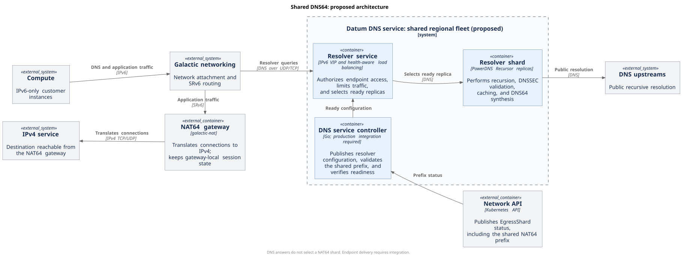
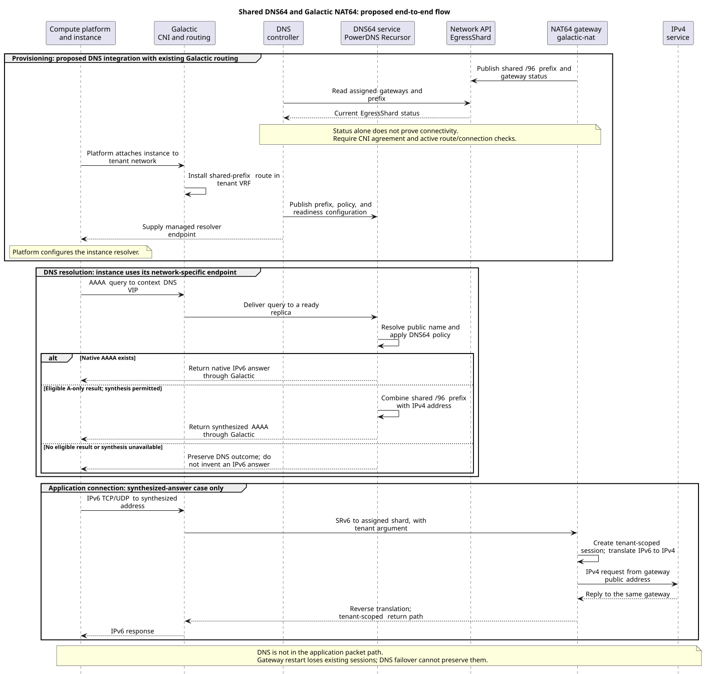

# Shared DNS64 service

Status: Prototype. Galactic implements service routing between attachments on
the same node. Production DNS64/NAT64 packet-path validation is incomplete.
The prototype is not production-ready.

## Summary

This design proposes a managed DNS64 service for IPv6-only Compute instances.
PowerDNS Recursor resolves public names. When a name has eligible A records
but no usable native AAAA record, the resolver synthesizes AAAA records.
Galactic's NAT64 gateway translates connections to IPv4.

The proposed service uses a shared regional resolver fleet and one `/96` NAT64
prefix per serving fabric. The planning range is 10,000 to 100,000 tenants.
This range is not a verified capacity limit. Resolver capacity scales with
traffic and configuration size, without a separate deployment for each tenant.

## Goals

- Resolve public names for IPv6-only instances.
- Synthesize eligible AAAA records with the shared NAT64 prefix.
- Provide a stable IPv6 resolver address through the Compute network path.
- Scale resolver capacity through shared replicas.
- Validate DNS security, abuse controls, failover, and NAT64 connectivity.
- Report resolver health, query failures, synthesis, and NAT64 reachability.

## Non-goals

- Provide private zones, tenant-specific DNS views, or conditional forwarding.
- Provide tenant-specific caches, upstreams, or NAT64 prefixes.
- Build a DNS protocol engine or replace public authoritative DNS.
- Operate an open recursive resolver or public encrypted DNS endpoints.
- Support IPv4 literals or make unreachable destinations reachable.
- Preserve connections when a NAT64 gateway loses session state.

## Current implementation

### Internal service resources

The [Network API][service-route-api] defines two internal resources:

- `ServiceEndpoint` publishes a stable service address, protocol, and port.
  Its `attachmentRef` identifies the Cloud API `VPCAttachment` that hosts the
  service. Galactic requires this reference for local service routing.
- `ServiceRoutePolicy` references an endpoint in the same namespace and selects
  consumer attachments by label. The network control plane must assign labels
  that grant service access.

These resources support shared services without a customer-facing DNS64 API.
The controller programs routes directly instead of creating a Kubernetes route
resource for each attachment or node. The policy status schema contains
conditions rather than attachment counts. The current controller does not
publish those conditions.

### Local routing

[Galactic's service-route controller][service-route-programming] runs inside
`galactic-router`. It watches both service resources and Cloud
`VPCAttachment` changes. Galactic uses `VPCAttachment.status.node` to determine
which node hosts each attachment. Router permissions allow the controller to
read and watch these APIs.

Each router reconciles consumer attachments assigned to its node. The service
attachment must be on the same node. Galactic reads attachment status to
identify the consumer subnet, both VPCs, and their host interfaces. It programs
bidirectional routes in the VPC virtual routing and forwarding (VRF) tables:

- The consumer VPC table routes the endpoint address to the service interface.
- The service VPC table routes the consumer subnet to the consumer interface.

Galactic also programs matching eBPF pass-through route-map entries in both
VRFs. These entries keep service traffic on the local Linux routing path
instead of sending it through an egress gateway.

### Route cleanup and rollback

After computing the desired routes, the controller removes the policy's
tracked routes and pass-through entries. It then applies the replacement.
This process removes stale routes after selection or attachment placement
changes. When a policy no longer exists, the controller removes its tracked
routes.

Updates are not atomic. Rollback covers only these failures:

- If the return route fails to install, the programmer attempts to remove the
  forward route.
- If the service-side pass-through entry fails to install, the programmer
  attempts to remove the consumer-side entry. It leaves the Linux routes in
  place.

Rollback does not restore the previous policy state. Cleanup relies on
in-memory tracking, which the controller loses on restart. Failed updates can
leave partial state. Endpoint lookup and route planning errors leave existing
routes in place. Deleting an endpoint alone does not withdraw its routes.

### Metrics and logs

[Service-route metrics][service-route-observability] use the existing
`galactic-router` Prometheus endpoint. They report reconciliation outcomes and
duration, route apply and remove outcomes, and the number of locally tracked
route intents. Each route intent describes a bidirectional service route.

Metric labels use only a fixed set of result and operation values. Labels
exclude resource identities to keep the number of time series bounded.
Structured logs provide policy and node context, endpoint context when
available, route intent counts, and errors from lookup, planning, programming,
or cleanup. The route count reflects controller tracking. It does not verify
resolver health or packet delivery.

### Limitations

- Routing supports consumer and service attachments on the same node only.
  Cross-node service routing is future work.
- Route programming requires Linux.
- NAT64 translation, NAT64 routes, and default-route programming remain outside
  this controller.
- The controller does not withdraw endpoints based on health.
- The route programmer does not enforce policy protocol and port restrictions.
- The controller does not check DNS64 readiness. The readiness requirements
  appear in [DNS64 readiness](#dns64-readiness).

## Proposed architecture

The following design requires further DNS64 integration and validation.

Use PowerDNS Recursor as the recursive DNS64 engine. Its
`recursor.dns64_prefix` setting configures the shared `/96` prefix for
[RFC 6147][dns64-rfc] synthesis. The proposed DNS service controller publishes
resolver configuration and readiness. Galactic provides network isolation,
resolver routing, and NAT64 forwarding. Defer dnsdist and authoritative DNS
components until a capability requires them.

A resolver shard is a group of PowerDNS Recursor replicas with defined
capacity limits. Size shards by query rate, cache size, and operational limits.
Use a shared resolver address for each serving region. Workload attachment
and routing determine which networks can reach that address.



[Container diagram source](containers.puml).

### Endpoint access and resource limits

Use a stable virtual IP address (VIP) for the resolver service. Galactic selects
eligible workload attachments for routing. The attachment and resolver service
must reject spoofed sources and unauthorized queries.

Limit shard memory, connections, outstanding queries, and query rates. Apply
access control lists (ACLs) and rate limits consistently across replicas.
Reject client EDNS Client Subnet options. Do not send these options to public
upstreams unless a privacy review approves an exception.

### Resolution and connection flow

The Compute platform configures the instance resolver. The instance uses DNS
over TCP or UDP. The DNS service controller does not handle queries.



[Sequence diagram source](resolution-sequence.puml).

DNS does not select a NAT64 gateway. Synthesized addresses use the shared
prefix, and application traffic returns through the same translation path.
The [CNI route implementation][cni-routes] and
[NAT64 gateway design][nat64-design] define this egress path.

### DNS64 readiness

Require agreement between the resolver VIP, the Galactic route, and the shared
NAT64 prefix before declaring DNS64 ready:

- The resolver VIP that Compute supplies to the instance matches the routed
  service endpoint.
- Galactic provides working routes to the resolver and back to the consumer.
- The resolver's synthesis prefix matches the shared prefix that Galactic
  routes to the assigned NAT64 gateway.

Read the prefix from [`EgressShard.status.nat64Prefix`][egress-status]. Do not
allocate prefixes in the DNS service. Verify that assigned NAT64 shards and
the CNI configuration use the same prefix before enabling synthesis.

Check current gateway status, installed routes, and IPv4 connections. The
current [`Ready` condition][shard-readiness] reports an attached translation
program. It does not verify IPv4 connectivity. Operators must provide
[IPv4 return routing][return-routing].

If the prefix is missing or inconsistent, disable synthesis and report the
reason. Native IPv6 resolution can continue. When the prefix changes, retain
routes for cached synthesized answers until their time to live (TTL) expires.

### Synthesis and DNS security

Follow [RFC 6147][dns64-rfc]. Synthesize only for AAAA queries with eligible
A records and no usable native AAAA record. Preserve NXDOMAIN, negative
answers, and upstream errors. Exclude IPv4 literals, special-use names, and
destinations that policy prohibits.

Enable PowerDNS Recursor DNSSEC validation. If validation returns `Bogus`, do
not synthesize an answer. The resolver generates synthesized records without
signatures from the original zone. Validate signed IPv4-only names, unsigned
names, SERVFAIL, and negative answers.

Use public-root trust anchors and query-name minimization. Apply ACLs and
limits on response rates, response sizes, and resource use to reduce cache
poisoning, amplification, and denial-of-service risk.

### Configuration and rollout

The proposed DNS service controller distributes versioned configuration to
resolver shards. The configuration includes the shared prefix, public upstream
policy, ACLs, synthesis exclusions, resource limits, and observability settings.
The controller does not manage tenant zones or DNS records.

Validate each revision before activation. Retain the previous revision for
rollback. Before upgrading a replica, drain it. After the upgrade, verify its
health and synthesis behavior before returning it to service. Admit a shard
only after its configuration and resolver health pass the DNS64 readiness
checks.

### Availability and capacity

Place resolver replicas across failure domains within each region. Keep enough
spare capacity to lose a replica. Use backend health checks to select replicas
behind the stable VIP. Rebuild caches after a failure.

Measure query latency, error rate, synthesis rate, cache hit rate, resolver
resource use, and NAT64 connection success. Limit metric cardinality and query
log retention. Add tenant-level accounting only if quotas or billing require it.

## Required validation

Production DNS64/NAT64 packet-path validation is incomplete. The earlier lab
prototype used dnsdist, BIND, and Jool. Validate PowerDNS Recursor with the
shared prefix and the intended Galactic/NAT64 path. Keep Jool as a test
fixture only.

The Galactic compatibility profile validates saved configuration offline. It
does not verify packet delivery. Controlled upstreams and replicas on the same
host do not establish public DNS performance or availability across failure
domains.

The NAT64 implementation reviewed on September 16, 2026, supports TCP and UDP.
It lacks ICMP translation, fragmentation handling, and path MTU discovery. It
does not provide full [RFC 6146][nat64-rfc] behavior. A gateway restart loses
session state. For details, see the [datapath limits][nat-limits] and
[gateway design constraints][nat64-constraints].

Before a production pilot, complete these checks:

- Verify resolver access and unauthorized-source rejection through Galactic.
- Test native AAAA, synthesized AAAA, DNSSEC failures, exclusions, negative
  answers, and upstream failures.
- Verify NAT64 routing and the IPv4 return path with TCP and UDP. Test gateway
  restarts, stale status, and large packets.
- Test route cleanup and recovery after policy changes, attachment moves,
  controller restarts, and programming failures.
- Validate resolver shard limits, cache behavior, rate limits, rolling
  upgrades, configuration rollback, and failover.
- Run load and abuse tests at 1,000, 5,000, and 10,000 aggregate queries per
  second per shard.

Before production, define service objectives and validate control-plane
recovery. Resolve NAT64 protocol limits or document accepted product
restrictions.

## Diagram maintenance

Edit the PlantUML sources, then regenerate both SVG files from the repository
root. PlantUML 1.2026.5 and its bundled C4 library produced these diagrams.

```sh
plantuml -tsvg docs/enhancements/dns64/containers.puml docs/enhancements/dns64/resolution-sequence.puml
```

[nat64-design]: https://github.com/datum-cloud/enhancements/blob/a778a6c3104b60b0e7634af4f3e5d2e3ae303549/enhancements/networking/nat64-gateway-for-vpc-networks.md#L184-L198
[egress-status]: https://github.com/datum-cloud/network/blob/ec15d7bda7eb47960a5e2b38daa4d30d42b12748/api/v1alpha1/egressshard_types.go#L90-L114
[cni-routes]: https://github.com/datum-cloud/galactic/blob/846f5d2a189f2849e044de3b383b5ca7be759777/internal/cnibgp/bgp.go#L759-L834
[shard-readiness]: https://github.com/datum-cloud/galactic/blob/846f5d2a189f2849e044de3b383b5ca7be759777/internal/controller/egressshard_controller.go#L286-L303
[return-routing]: https://github.com/datum-cloud/galactic/blob/846f5d2a189f2849e044de3b383b5ca7be759777/internal/controller/egressshard_controller.go#L180-L184
[nat-limits]: https://github.com/datum-cloud/galactic/blob/846f5d2a189f2849e044de3b383b5ca7be759777/internal/plumbing/ebpf/natprog/nat.c#L74-L92
[nat64-constraints]: https://github.com/datum-cloud/enhancements/blob/a778a6c3104b60b0e7634af4f3e5d2e3ae303549/enhancements/networking/nat64-gateway-for-vpc-networks.md#L184-L198
[dns64-rfc]: https://www.rfc-editor.org/rfc/rfc6147.html
[nat64-rfc]: https://www.rfc-editor.org/rfc/rfc6146.html
[service-route-api]: https://github.com/datum-cloud/network/pull/27
[service-route-programming]: https://github.com/datum-cloud/galactic/pull/634
[service-route-observability]: https://github.com/datum-cloud/galactic/pull/635
