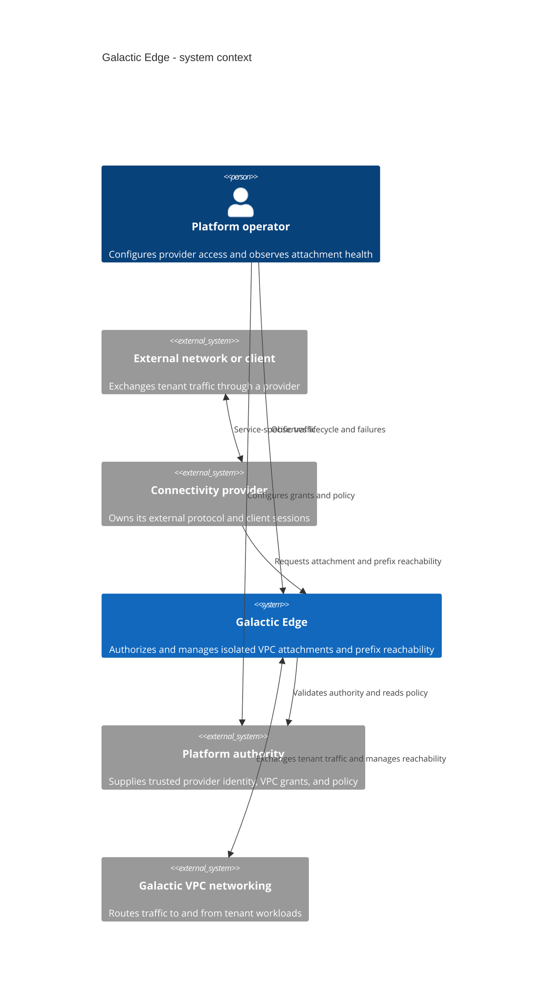
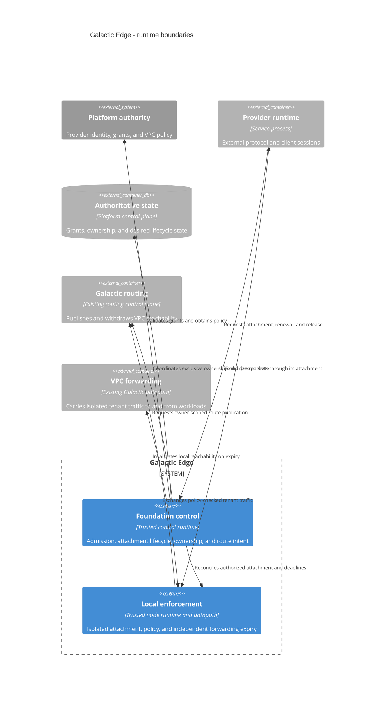
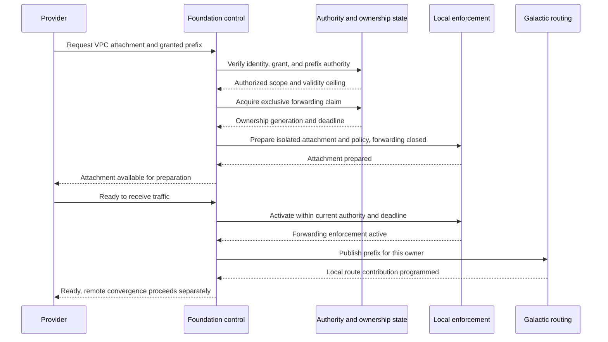
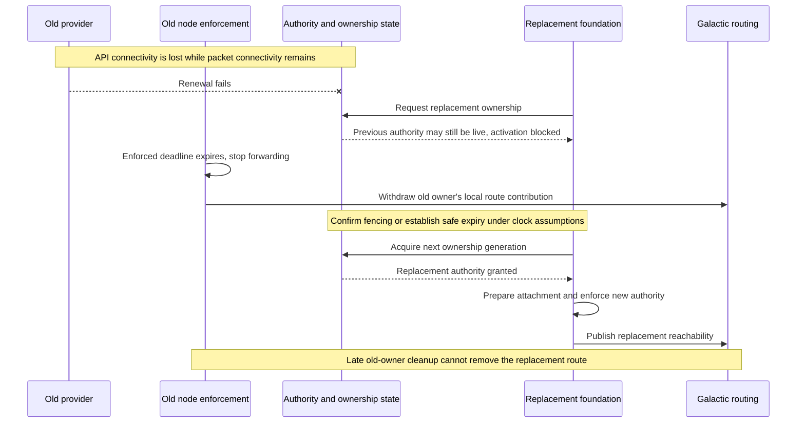

# Galactic Edge Foundation

Tracking issue: [Galactic Edge Foundation (#992)](https://github.com/datum-cloud/galactic/issues/992).

This draft follows the [Datum enhancement template](https://github.com/datum-cloud/enhancements/blob/main/enhancements/template/README.md). The architecture is proposed; this document does not assert that it is implemented.

- [Summary](#summary)
- [Motivation](#motivation)
- [Proposal](#proposal)
- [Design Details](#design-details)
- [Production Readiness Review Questionnaire](#production-readiness-review-questionnaire)
- [Implementation History](#implementation-history)
- [Drawbacks](#drawbacks)
- [Alternatives](#alternatives)

## Summary

Galactic Edge is a common foundation for services that connect external networks and clients to gVPC workloads. A service integrates as a **provider**: it requests an authorized tenant attachment and declares which authorized prefixes it can serve. The foundation supplies isolation, gVPC traffic policy, route lifecycle, recovery, and exclusive forwarding ownership.

Providers own their protocols and client sessions. Galactic Edge owns the boundary between those services and shared VPC networking. A new provider should integrate through the same contract without changing the foundation or receiving direct access to shared host networking.

## Motivation

External connectivity services need many of the same networking guarantees, even when their protocols differ. Each needs a tenant-specific path into the VPC, a return path, authorization, policy enforcement, and safe cleanup when an instance fails or moves. Reimplementing these responsibilities in each service creates competing writers and inconsistent failure behavior.

Galactic Edge makes these guarantees reusable while retaining the existing Galactic routing and SRv6 data plane. It gives service authors a small integration boundary and operators one model for attachment health and ownership.

### Goals

- Connect independently developed providers to authorized gVPCs through one internal contract.
- Isolate tenants, including tenants using identical addresses.
- Publish prefix reachability only while authorization, attachment readiness, and exclusive forwarding ownership remain valid.
- Bound forwarding expiry and route withdrawal during failure, including API outages and stalled providers.
- Recover owned resources without disrupting workloads or other services.

### Non-Goals

- Define public customer APIs, enrollment experiences, or client software.
- Specify a transport protocol, credential format, prefix size, or session migration mechanism.
- Replace Galactic's routing control plane or build a general networking plugin marketplace.
- Migrate every existing gateway or NAT service into the framework.
- Define concrete schemas, RPC methods, kernel objects, or deployment manifests.

## Proposal

Introduce Galactic Edge as the trusted intermediary between service providers and gVPC networking. Its first contract supports isolated packet attachments and authorized prefix reachability. Additional capabilities should be added only when a concrete consumer requires them.

### System context — C4 level 1

The framework is the system of interest. Providers and existing Galactic networking are separate systems with explicit responsibilities.

### Core concepts

| Concept             | Meaning                                                                                                               |
| ------------------- | --------------------------------------------------------------------------------------------------------------------- |
| Provider            | An authenticated service integration; its running instances own protocol-specific sessions.                           |
| Grant               | Trusted authorization for a provider to use a particular gVPC and specified prefixes, within a validity period.       |
| Attachment          | An isolated connection between a provider instance and one gVPC, with policy and lifecycle managed by the foundation. |
| Forwarding claim    | Time-bounded, exclusive authority for an instance to forward for a particular grant.                                  |
| Prefix reachability | The routes that direct traffic for an authorized prefix to its current forwarding owner.                              |

A grant can outlive an individual connection. An attachment can exist while forwarding is disabled. A retained prefix does not imply that a route remains advertised. Keeping these lifetimes separate allows reconnects and recovery without leaving stale forwarding authority behind.

### Representative provider

Consider a service that connects an external site to a tenant's VPC. It establishes a session with that site and carries packets for an authorized site prefix. The protocol and prefix length are immaterial to this example.

The provider requests an attachment for the tenant and reachability for the prefix. Galactic Edge verifies the grant, prepares the isolated connection, and enables forwarding and routing only when their prerequisites hold. Return traffic follows the published prefix to the attachment; the provider delivers it to the external site.

A second service using a different protocol follows the same lifecycle. This is the reuse requirement in [#992](https://github.com/datum-cloud/galactic/issues/992), illustrated through an abstract provider. The [MASQUE proposal (#970)](https://github.com/datum-cloud/galactic/issues/970) is one potential consumer; its transport requirements are outside this design.

### Risks and Mitigations

| Risk                                                   | Architectural response                                                                              |
| ------------------------------------------------------ | --------------------------------------------------------------------------------------------------- |
| A provider requests another tenant's resources         | Validate trusted grants; provider-supplied identities and prefixes are requests, not authorization. |
| An old instance continues forwarding after replacement | Independently enforce local expiry and require fencing before replacement activation.               |
| Cleanup removes a replacement's resources              | Bind every mutation to immutable ownership identity and the current ownership generation.           |
| A provider exhausts shared capacity                    | Bound attachments, prefixes, requests, and buffering; reject excess work before allocation.         |
| The framework accumulates service-specific behavior    | Prove integration with an independent provider against unchanged core artifacts.                    |

## Design Details

### Runtime boundaries — C4 level 2

The diagram separates the provider runtime, trusted foundation runtime, authoritative state, and existing routing and forwarding systems. The foundation's control and local enforcement responsibilities may require separate processes; their packaging is a contract-design decision.

The state boundary is logical: this proposal does not require a new database. Likewise, Galactic Edge reuses the existing routing system rather than introducing another BGP implementation. Local withdrawal must have an API-independent enforcement path; writing desired state to an unavailable API is insufficient.

### Responsibility split

The provider authenticates its clients, implements its external protocol, checks session-specific packet ownership, and handles connection recovery. It cannot expand its VPC or prefix authority by asserting a client identity.

The foundation authenticates the provider and validates grants against trusted authority. It owns shared attachment resources, enforces gVPC policy in both directions, constrains traffic to the admitted tenant and prefix scope, and coordinates forwarding claims and routes. Provider checks can narrow access; they cannot replace foundation enforcement.

Existing Galactic components continue to own their routing and forwarding subsystems. Their reconciliation, repair, refresh, and garbage collection must respect foundation resource ownership. A provider receives access only to its attachment, never unrestricted control of shared routes or host networking.

### The provider contract

The contract needs a small set of capabilities: request an attachment, request reachability for granted prefixes, observe readiness and failures, renew forwarding authority, and drain or release resources. It must define compatible versions and reject unsupported capabilities before provisioning.

Requests are scoped to immutable provider-instance and tenant identities. Retries are idempotent. Readiness reflects installed attachment and policy state, valid ownership, and local route programming; it does not promise that every remote router has converged.

A provider may serve multiple tenants, but every packet enters through an explicit tenant attachment. Identical addresses in separate VPCs remain independent. Conflicting prefix ownership within one VPC is rejected.

### Attachment activation

Preparation starts with forwarding closed. A claim alone is insufficient: local enforcement must be installed, the provider must be ready to receive traffic, and any previous owner must already be fenced.

Every step rechecks the authority relevant to its mutation. Failed or partial activation remains unready and is reconciled or cleaned up. Work completed under expired authority cannot later become active through a delayed retry.

### Failure and ownership replacement

Forwarding authority expires independently of provider cooperation and API availability. The local forwarding gate must stop traffic even if the provider or its control loop stalls. Renewal cannot extend authority beyond the grant's validity ceiling.

Replacement waits until the old owner cannot forward, using confirmed fencing or a safely elapsed enforcement deadline under the defined clock assumptions. An unreachable owner is not proof of a fenced owner. A temporary outage is preferable to two active owners for the same grant.

The sequence shows required ordering, not a chosen lease algorithm. Numeric forwarding-expiry, revocation, and local-withdrawal bounds, including their clock and failure assumptions, must be resolved in the [contract milestone (#993)](https://github.com/datum-cloud/galactic/issues/993). Remote route convergence is measured separately. Stale remote routes may cause packet loss, but must not restore expired local forwarding authority.

On restart, cached state is evidence for reconciliation, not permission to resume forwarding. Revalidate authority before reopening the attachment.

### Drain, cleanup, and policy updates

Drain stops new admissions and lets the provider finish existing work within a bounded window. Final release closes forwarding, withdraws the owner's reachability, and removes its attachment resources. Prefix retention follows the grant's lifecycle rather than the session's lifecycle.

Recovery and cleanup use the same ownership rules as normal operations. They must preserve replacement routes, other providers' attachments, and shared VPC resources still in use.

Policy changes apply to active attachments. Missing or invalid required policy keeps affected forwarding closed, with explicitly permitted control traffic preserved. Revocation shortens authority; it does not wait indefinitely for a provider to acknowledge it. During disconnection, previously granted authority can last only until its independently enforced deadline.

## Production Readiness Review Questionnaire

This provisional draft records the readiness expectations. Measurements and mechanism-specific answers are required before the design becomes implementable.

### Feature Enablement and Rollback

Enable the foundation and each provider explicitly. Existing services retain their current behavior. Disable by stopping admission, draining or fencing active owners, withdrawing routes, and cleaning up owned resources. Removing a deployment alone is not a complete rollback procedure.

### Rollout, Upgrade and Rollback Planning

Qualify an independent provider against fixed core artifacts on the target Talos/Cilium environment. Test overlapping tenants, unauthorized requests, policy changes, partial setup, provider crash and pause, API isolation, restart, cross-node replacement, and delayed cleanup. Capture packet evidence and failure timings. Upgrade and rollback must preserve the same ownership rules and reject incompatible contracts before activation.

### Monitoring Requirements

Expose admission failures, attachment readiness, active ownership and expiry, policy drops, route publication and withdrawal, resource use, and cleanup failures. Operators should be able to distinguish an unauthorized request, an unready attachment, expired ownership, and routing convergence without inspecting the provider's protocol internals.

### Dependencies

The foundation depends on trusted identity and grant state, gVPC policy, existing Galactic routing and forwarding, and supported node networking. Authority outages prevent new ownership and renewals; existing forwarding ends at its enforced deadline. Routing outages can delay remote reachability but cannot extend forwarding authority.

### Scalability

Set and test limits for providers, attachments, claims, prefixes, reconciliation work, and packet resources. Measure steady-state operation and renewal or reconnect bursts. No capacity or throughput target is claimed by this draft.

### Troubleshooting

Report lifecycle state and the reason progress stopped, correlated by provider, attachment, grant, and ownership generation. Measure local forwarding cutoff, local route withdrawal, and remote convergence separately. Avoid one health indicator that hides these distinct failure domains.

## Implementation History

- 2026-10-22: Initial architecture enhancement drafted, based on [#992 and its milestones](https://github.com/datum-cloud/galactic/issues/992). No implementation or qualification results are claimed here.

## Drawbacks

The shared foundation becomes a dependency for every adopting provider. Its contract needs careful evolution, and its privileged scope requires strong isolation tests. Exclusive ownership also introduces an intentional gap in availability when safe replacement requires waiting for expiry.

## Alternatives

**Each service owns its networking.** This permits independent development but duplicates authorization, resource recovery, and fencing. It also creates multiple writers to shared networking state.

**Share a helper library only.** A library can reduce duplicate code, but does not by itself establish a trusted owner for shared resources or enforce expiry when its caller stalls. Libraries may support the foundation internally.

**Build one service containing every protocol.** This centralizes ownership but couples protocol releases and failures. Independent providers preserve a smaller common framework and separate service lifecycles.
