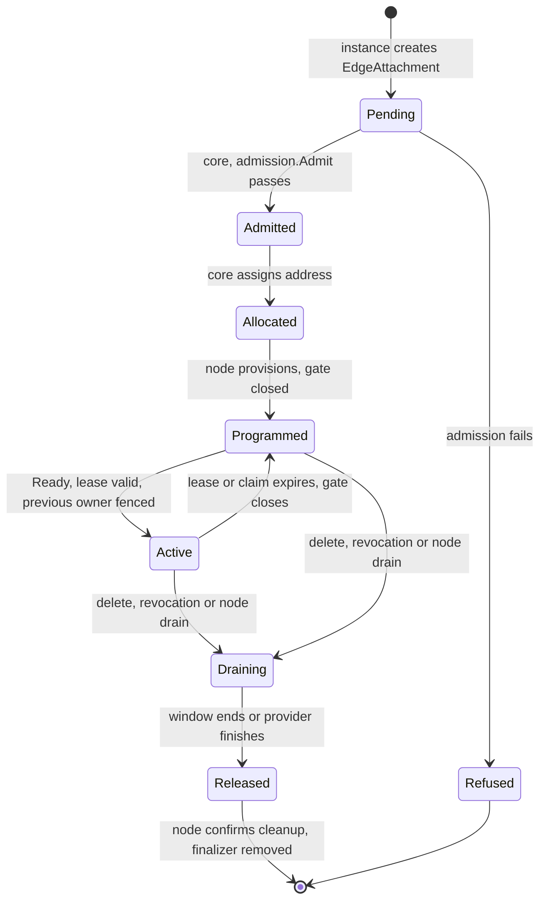
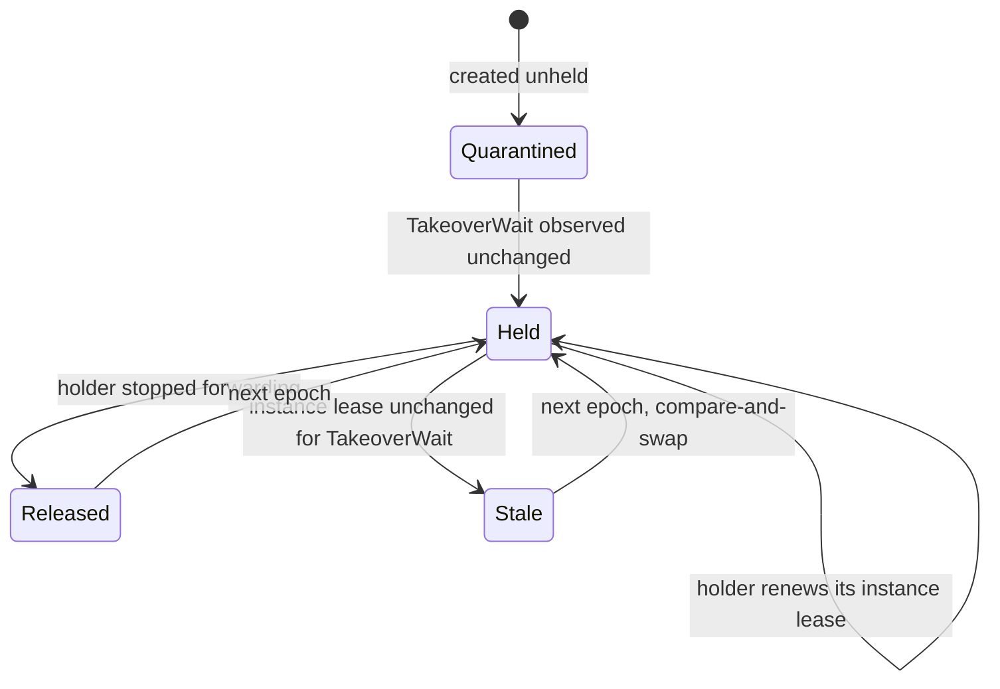

# Galactic Edge provider contract

Tracking issue: [Define the internal provider contract (#993)](https://github.com/datum-cloud/galactic/issues/993), part of [#992](https://github.com/datum-cloud/galactic/issues/992).

This document is the contract the [Galactic Edge foundation](README.md) is built to. It fixes the resources, writers, state transitions, timing bounds and acceptance tests that the implementation milestones (#994 to #1002) follow. Where it names existing code, the reference is to `main`; where it names a resource or process that does not exist yet, it is a decision, not a description.

- [Decisions](#decisions)
- [Resources](#resources)
- [Provider interface](#provider-interface)
- [Lifecycle](#lifecycle)
- [Timing and failure bounds](#timing-and-failure-bounds)
- [Foundation resources and their writers](#foundation-resources-and-their-writers)
- [Failure-test matrix](#failure-test-matrix)
- [Open items](#open-items)

## Decisions

| Area                    | Decision                                                                                                                                                                                                                                                                                                                                         |
| ----------------------- | ------------------------------------------------------------------------------------------------------------------------------------------------------------------------------------------------------------------------------------------------------------------------------------------------------------------------------------------------ |
| Contract representation | Kubernetes resources in `galactic.datumapis.com/v1alpha1`. A provider talks only to the cell's API server; there is no provider RPC.                                                                                                                                                                                                             |
| Contract version        | `v1alpha1`. Capabilities are versioned separately: `SocketAccess/v1`, `PacketAccess/v1`, `PrefixReachability/v1`.                                                                                                                                                                                                                                |
| Provider authority      | The API server's authentication of the provider pod's bound ServiceAccount token. A ValidatingAdmissionPolicy compares the token's pod UID and ServiceAccount with the object being written. Nothing a provider writes into a field is treated as its identity.                                                                                  |
| Control packaging       | Admission, allocation and publication run in `galactic-controller --role=cell`, leader-elected, one writer per cell.                                                                                                                                                                                                                             |
| Node packaging          | A new `galactic-edge` DaemonSet on nodes labeled `galactic.datumapis.com/node=edge` and `galactic.datumapis.com/edge=enabled`. It is the only process that changes host state for an edge attachment.                                                                                                                                            |
| Provider privilege      | None on the host. A provider pod gets no host namespace, hostPath, `NET_ADMIN` or BPF access. It opens the packet device the node agent created in its own network namespace.                                                                                                                                                                    |
| Claim store             | The cell's API server, compare-and-swap on `resourceVersion` with a UID precondition, as `internal/edge/claim` requires. Claims never span cells.                                                                                                                                                                                                |
| Node-local write fence  | `internal/edge/ownership`, with its state and lock files in the hostPath `/var/lib/galactic-edge/ownership`, shared by every process that writes a fenced scope on the node.                                                                                                                                                                     |
| Forwarding gate         | A pinned eBPF map row per edge host link and per claimed prefix, holding a `CLOCK_BOOTTIME` deadline that the datapath checks on every packet, the pattern `serviceroutemap` already uses for authorization deadlines.                                                                                                                           |
| Allocation              | Attachment addresses come from the service's client pool, allocated by the leader of `galactic-controller`. Delegated client prefixes are routes the provider requests inside that pool; the prefix conflict check makes them exclusive. No new host table or uSID Argument is allocated: an edge attachment joins the VPC's canonical host VRF. |

## Resources

All resources are in `galactic.datumapis.com/v1alpha1`. Object names that carry identity are derived, so a retried create lands on the same object.

| Kind             | Scope     | Name                         | Purpose                                                                     |
| ---------------- | --------- | ---------------------------- | --------------------------------------------------------------------------- |
| `EdgeProvider`   | Cluster   | Operator's choice            | Registration: contract and capability versions, ServiceAccounts, privilege. |
| `EdgeService`    | Namespace | Platform authority's choice  | Grant: one provider, one gVPC, prefixes, client pool, validity.             |
| `EdgeInstance`   | Namespace | Provider pod name            | One running provider process and its liveness lease.                        |
| `EdgeAttachment` | Namespace | `hash(service UID, pod UID)` | One instance's isolated connection to the service's gVPC.                   |
| `EdgeRoute`      | Namespace | `hash(gVPC UID, prefix)`     | One prefix's forwarding claim and publication.                              |

`EdgeInstance`, `EdgeAttachment` and `EdgeRoute` live in the provider's namespace. `EdgeService` lives in the namespace of the gVPC it references.

### Fields and writers

A field not listed is read-only to everyone but the control plane that owns the resource. "Core" is `galactic-controller --role=cell`; "node" is `galactic-edge` on the attachment's node.

| Resource and field                                                      | Writer                                | Rule                                                                       |
| ----------------------------------------------------------------------- | ------------------------------------- | -------------------------------------------------------------------------- |
| `EdgeProvider.spec`                                                     | Operator                              | Contract versions, capabilities, ServiceAccounts, configuration kind.      |
| `EdgeProvider.status.approved`                                          | Operator approval role                | No provider ServiceAccount holds `edgeproviders/status`.                   |
| `EdgeService.spec`                                                      | Platform authority                    | `providerRef`, `vpcRef.uid` and capabilities are immutable.                |
| `EdgeService.status`                                                    | Core                                  | `Admitted` condition and allocation summary.                               |
| `EdgeInstance.spec` (`podUID`, `nodeName`, `bootID`)                    | The instance, at create               | Immutable. Must match the token's pod UID and the pod's node.              |
| `EdgeInstance` lease fields                                             | The instance                          | `holder`, `incarnation`, `epoch`, `sequence`, `renewStart`, `released`.    |
| `EdgeAttachment.spec` (`serviceRef`, `instanceRef`, capabilities)       | The instance, at create               | Immutable. The instance must belong to the service's provider.             |
| `EdgeAttachment.status` `Admitted`, `Allocated`, `Published`            | Core                                  | As `admission.MaySetCondition` allows.                                     |
| `EdgeAttachment.status` `Programmed`, device names, `gateGeneration`    | Node                                  | Set only after `hostattach.Readback` succeeds.                             |
| `EdgeAttachment.status` `Ready`                                         | The instance                          | The only condition a provider sets.                                        |
| `EdgeAttachment` finalizer                                              | Core                                  | Removed after the node confirms release.                                   |
| `EdgeRoute.spec` (`vpcRef.uid`, `prefix`, `attachmentRef`)              | An instance of the service's provider | `vpcRef` and `prefix` immutable; `attachmentRef` changes only on takeover. |
| `EdgeRoute` claim fields (`holder`, `epoch`, `incarnation`, `released`) | An instance of the service's provider | Compare-and-swap only; `admission.MayWriteClaim`.                          |
| `EdgeRoute.status` `Accepted`, `Published`                              | Core                                  | `Accepted` requires the grant and no conflict.                             |
| `BGPAdvertisement` for an `EdgeRoute`                                   | Core                                  | Owner reference to the `EdgeRoute`, labeled with its epoch.                |

## Provider interface

A provider integrates in five steps, all through its own ServiceAccount.

1. **Register.** The operator creates the `EdgeProvider` and approves it. Registration grants no tenant authority (`internal/edge/admission/admission.go:44`).
2. **Start an instance.** Each provider process creates or adopts its pod's `EdgeInstance` and renews it every 5 s. The holder ID is new for every process start, so a restarted container cannot continue its predecessor's lease (`internal/edge/claim/claim.go:226`).
3. **Request an attachment.** The instance creates `EdgeAttachment` for an `EdgeService` that names its provider. Core runs `admission.Admit` (`internal/edge/admission/admission.go:91`) before allocating anything, and refuses with the reasons defined there. The instance waits for `Programmed`, opens the packet device or binds its sockets to the pod VRF named in status, then sets `Ready`.
4. **Request reachability.** For each prefix it serves, the instance creates or takes over the `EdgeRoute`. Core accepts it only if the prefix is inside the service's grant (`PrefixNotGranted`), is not held by another `EdgeRoute` in the same gVPC (`PrefixConflict`), and its attachment is `Ready`.
5. **Drain and release.** The instance deletes its `EdgeRoute`s and `EdgeAttachment`s, or sets `released` on a claim after it has stopped forwarding. Core drains the same way when a service, grant or node goes away.

### Compatibility

- A request names one contract version and one version per capability. An unsupported version is refused before allocation with `UnsupportedContractVersion` or `UnsupportedCapability`.
- A core release supports the current contract version and the one before it. Dropping a version requires that no `EdgeProvider` still lists it as its only version.
- Adding a capability adds a new name; it never changes what an existing version means.

### Authorization context

The foundation decides every request from three inputs, and nothing else:

1. **Who is asking.** The authenticated ServiceAccount and pod UID from the request's bound token. The ValidatingAdmissionPolicy rejects a write whose `podUID`, `instanceRef` or ServiceAccount does not match, so one provider pod cannot write another pod's instance, attachment or claim.
2. **What the provider may do.** The approved `EdgeProvider`.
3. **What the tenant granted.** The `EdgeService`, written by the platform authority: one gVPC, capabilities, prefixes, client pool and an optional `validUntil`.

Client identities, prefixes and session state that a provider learns from its own clients can narrow what it requests. They never widen it, and the foundation never reads them. The provider checks packet ownership per client session; the foundation independently limits every packet on the attachment to the attachment address and the prefixes the instance currently holds.

### Idempotency

- Every create uses a derived name. `AlreadyExists` is answered by reading the object and comparing its immutable fields; a mismatch is refused with `IdentityConflict`, never overwritten.
- Claim writes are compare-and-swap. A lost reply is recovered as `claim.Instance.Renew` does: the writer rereads, and validity always runs from the start of the latest call.
- Node mutations go through `ownership.Authority.Commit` (`internal/edge/ownership/ownership.go:162`), which refuses a ticket issued before another commit. A retry built from an old view cannot undo newer state.

### Readiness

`Ready` on an attachment means only that the provider can take traffic. `Published` means:

- core admitted and allocated it,
- the node programmed and read it back, including traffic policy,
- the instance's lease and the route's claim are valid,
- the node opened the forwarding gate, and
- the node's `galactic-router` installed the advertisement locally.

`Published` does not mean remote routers have converged. That is measured separately (see [Timing and failure bounds](#timing-and-failure-bounds)).

## Lifecycle

### Attachment

| Transition              | Writer | Guard                                                                                                                |
| ----------------------- | ------ | -------------------------------------------------------------------------------------------------------------------- |
| Pending to Admitted     | Core   | Provider approved, versions supported, gVPC and capabilities granted, capacity available.                            |
| Admitted to Allocated   | Core   | An address in the client pool that no other attachment holds.                                                        |
| Allocated to Programmed | Node   | Pod is on this node with the recorded UID; `hostattach.Provision` and `Readback` succeed; traffic policy rows exist. |
| Programmed to Active    | Node   | `Ready`, a lease valid on fresh reads, and no earlier generation of the same claim can still forward.                |
| Active to Programmed    | Node   | The kernel deadline passed or the claim moved; the node closes the gate and records it.                              |
| Any to Draining         | Core   | Deletion, `EdgeService` deleted or revoked, `validUntil` reached, or node maintenance.                               |
| Draining to Released    | Node   | Gate closed, routes withdrawn locally, `hostattach.Release` done, policy rows removed.                               |

A failed step leaves the attachment in its last state with a condition naming the reason. Partial host state carries the attachment ID in the host link's alias, so the node finds and finishes it on restart (`internal/edge/hostattach/inventory.go:33`).

### Forwarding claim

Each `EdgeRoute` is the claim for one prefix in one gVPC. Its holder is valid only while the holder's `EdgeInstance` lease is: an instance renews one lease, not one per route.

The record and its takeover rules are those of `internal/edge/claim`. A deleted and recreated record gets a new incarnation and starts quarantined again, so deletion never shortcuts the wait. The fencing identity is the incarnation and epoch together.

### Drain

A drain stops new routes and attachments for its scope at once. Forwarding continues until the earlier of the drain window (`EdgeService.spec.drainSeconds`, default 30, maximum 300) and the lease deadline. The node then closes the gate, `galactic-router` withdraws, and the attachment is released. A grant's prefixes stay assigned to the service across drains; only its routes go.

### Restart and replacement

| Event                                | Rule                                                                                                                                                                                          |
| ------------------------------------ | --------------------------------------------------------------------------------------------------------------------------------------------------------------------------------------------- |
| Provider process restarts in its pod | New holder ID. It takes over its own instance lease after a release or `TakeoverWait`, like any other holder.                                                                                 |
| Provider pod replaced, same node     | New pod UID and `EdgeInstance`. Routes move by takeover. The old attachment drains.                                                                                                           |
| Replacement on another node          | As above. The old node's gate closes at its own deadline even if that node cannot reach the API.                                                                                              |
| `galactic-edge` restarts             | New ownership owner ID, `Fence`, `Adopt`, then a snapshot commit (`internal/edge/ownership/ownership.go:212`). It extends no deadline until it has read a renewal newer than the one applied. |
| `galactic-router` restarts           | Advertises an edge prefix only while its gate deadline, read from the pinned map, is in the future.                                                                                           |
| Node reboots                         | Pinned maps and leases from the previous boot are void: the boot ID changed. Every claim on that node is reacquired through the takeover rules.                                               |

Cached state is evidence to reconcile from, never permission to forward.

## Timing and failure bounds

### Parameters

Every holder and replacement in a cell uses the same values. `claim.Params.Validate` rejects values that cannot provide the guarantee.

| Parameter        | Value   | Basis                                                                                       |
| ---------------- | ------- | ------------------------------------------------------------------------------------------- |
| Lease `Duration` | 15 s    | Validity one renewal grants on the holder's `CLOCK_BOOTTIME`.                               |
| Renewal interval | 5 s     | Two consecutive renewals can fail without expiry.                                           |
| `MaxDrift`       | 0.001   | 1000 ppm relative rate error between any two nodes' monotonic clocks.                       |
| `Margin`         | 500 ms  | Delay between a deadline passing and forwarding actually stopping.                          |
| `TakeoverWait`   | 15.53 s | `Duration × (1 + MaxDrift) / (1 − MaxDrift) + Margin` (`internal/edge/claim/claim.go:149`). |
| `MaxSkew`        | 2 s     | Wall-clock error of any node; used only to convert `validUntil` into a deadline.            |
| Router gate poll | 250 ms  | How often `galactic-router` reads the gate deadlines of the prefixes it advertises.         |
| Drain window     | 30 s    | Default `drainSeconds`; at most 300 s.                                                      |

### Bounds

| Bound                               | Value                                        | Enforced by                                                                         | Holds while                                   |
| ----------------------------------- | -------------------------------------------- | ----------------------------------------------------------------------------------- | --------------------------------------------- |
| Local forwarding expiry             | 15.5 s after the last applied renewal starts | The datapath compares the gate deadline with `bpf_ktime_get_boot_ns`                | Provider, `galactic-edge` and API all stalled |
| Replacement activation              | Not before `TakeoverWait` or a release       | `claim.Instance.Acquire` and the node's gate check                                  | Any two nodes within `MaxDrift`               |
| Revocation                          | 15.5 s after it is recorded                  | `galactic-edge` applies a renewal only after reading the attachment and grant fresh | `galactic-edge` cut off from the API          |
| Revocation, connected               | Target 2 s after it is recorded              | `galactic-edge`'s watch closes the gate when it sees the revocation                 | Measured, not guaranteed                      |
| Grant ceiling                       | `validUntil − MaxSkew`                       | The lease deadline is capped by `claim.Instance.Ceiling`                            | Wall clocks within `MaxSkew`                  |
| Local route withdrawal              | 1 s after the gate deadline                  | `galactic-router` polls the pinned gate and withdraws with no API call              | `galactic-router` running                     |
| Local route withdrawal, router down | The BGP hold time of the node's session      | The route reflector drops the node's paths when the session expires                 | Route reflector running                       |
| Remote convergence                  | Target 5 s after local withdrawal            | BGP propagation                                                                     | Measured, not guaranteed                      |

The revocation bound works like this. `galactic-edge` extends a gate only after a renewal and a quorum read of the attachment, service and grant that shows them still valid. Any renewal applied after a revocation sees it. A renewal applied before the revocation expires within one lease.

### Clock and failure assumptions

- **Monotonic clock.** Each node's `CLOCK_BOOTTIME` advances at real time within `MaxDrift`, across suspend. Wall clocks are not assumed synchronized; only the grant ceiling uses them.
- **Shared node clock.** A provider and the `galactic-edge` serving it run on the same node, so the renewal start a provider records in its lease (`renewStart`, with `bootID`) is on the clock the gate uses. `galactic-edge` rejects a start later than its own reading or earlier than the one it already applied, and any record from another boot.
- **No VM pause.** A node whose clock stops while the node is paused can forward past its deadline in real time. Edge nodes that run edge attachments must be physical, or virtual with pause and live migration disabled.
- **Forged renewal starts.** A provider that records a start later than its true send time extends only its own forwarding, by no more than its write-to-observation delay, for prefixes it already holds. It cannot affect another provider or tenant.
- **Stale remote routes.** Until remote convergence, traffic can still arrive at the old node. The closed gate drops it. Stale routes cost packets; they never reopen forwarding.
- **Availability cost.** An API outage longer than 15 s stops every edge attachment in the affected scope. This is deliberate: two owners for one prefix is worse than an outage.

## Foundation resources and their writers

Foundation-owned host state is what `galactic-edge` creates for an attachment, plus the shared state it writes into. Today nothing on `main` uses `internal/edge/ownership`. Every writer below must commit through it, and must leave edge attachments alone, before any scope is adopted. Until then, `galactic-edge` refuses to program a scope (#996).

### Owned by `galactic-edge`

| Resource                                                                                  | Key                                | Other writers allowed                                                                                                     |
| ----------------------------------------------------------------------------------------- | ---------------------------------- | ------------------------------------------------------------------------------------------------------------------------- |
| Host veth `E<vpc9><handle5>`, alias `galactic-edge:hostattach:<id>`                       | Attachment ID                      | None. `hostattach.Release` refuses another ID's link.                                                                     |
| Pod VRF, pod link, TUN and routes inside the provider pod                                 | Attachment ID                      | None.                                                                                                                     |
| Host-table routes and permanent neighbors for the attachment                              | Host link ifindex                  | None.                                                                                                                     |
| uSID registration of the host link (`ifindex_vrf_table`, `ifindex_egress_kind_table`)     | Host link ifindex                  | None.                                                                                                                     |
| Traffic policy interface rows (`tp_iface_table`, `tp_iface_addr_table`) for the host link | Host link ifindex                  | None. `galactic-router`'s traffic-policy reconciler binds snapshots to the link in `tp_binding_table`, as for a workload. |
| Forwarding gate rows                                                                      | Host link ifindex, gVPC and prefix | None. `galactic-router` reads them.                                                                                       |
| Ownership records                                                                         | Scope (gVPC on the node)           | Every fenced writer, through `ownership.Authority`.                                                                       |

The host link name stays outside the CNI pattern `^G…H$` (`internal/gc/datapath_repair.go:33`), so datapath repair never mistakes an edge link for a workload.

### Shared, written by existing components

| Resource                                               | Writers on `main` today                                                                                                                                                                           | Required change                                                                                                                     |
| ------------------------------------------------------ | ------------------------------------------------------------------------------------------------------------------------------------------------------------------------------------------------- | ----------------------------------------------------------------------------------------------------------------------------------- |
| Canonical host VRF of a gVPC                           | CNI ADD (`internal/cni/ops_add.go:100`, `internal/cnitap/ops_add.go:101`); `galactic-router` GC (`internal/gc/gc.go:375`, from `internal/controller/gc_controller.go:40`)                         | GC counts a node's admitted `EdgeAttachment`s as references, so it never deletes a VRF an edge attachment uses.                     |
| `vrf_table` and per-VRF rows                           | `attachreg.RegisterDatapath` (`internal/plumbing/ebpf/attachreg/register.go:98`), `attachreg` fill, `galactic-cni`'s sweep (`internal/gc/gc.go:502`, from `internal/installer/installer.go:1276`) | Commit through the authority. The sweep counts edge attachments as references.                                                      |
| Attachment rows, during repair                         | `galactic-cni`'s datapath repair (`internal/gc/datapath_repair.go:121`)                                                                                                                           | Commit through the authority. Keep skipping links outside the CNI name pattern.                                                     |
| `egress_route_table`                                   | `galactic-router` VRF route install and retry (`internal/runtime/gobgp/vrfroutes.go:108`); `galactic-cni` egress group refresh (`internal/installer/egressgroup.go:678`)                          | Commit through the authority. A retry after `Fence` is refused.                                                                     |
| Sidecar return tables and rows                         | `galactic-cni` sidecar return (`internal/installer/sidecarreturn.go`), reaper (`internal/installer/sidecarreap.go:142`), the ingress sidecar (`internal/ingresssidecar/ebpfdatapath.go`)          | Commit through the authority, and never touch a table or row outside the sidecar's own ranges.                                      |
| Traffic policy snapshots                               | `galactic-router` traffic-policy reconciler (`internal/trafficpolicy/node/reconciler.go`); `galactic-cni` (`internal/installer/trafficpolicy.go`)                                                 | No change of writer. An edge host link is a policy subject like a workload interface; an unbound attachment denies everything.      |
| `BGPAdvertisement`                                     | CNI, `galactic-gateway`, the ingress sidecar, `galactic-controller`, GC (`internal/gc/gc.go:188`)                                                                                                 | Core writes edge advertisements with an owner reference to the `EdgeRoute`. GC's orphan rules skip objects owned by an `EdgeRoute`. |
| Kernel routes in the canonical table learned over EVPN | `galactic-router` (`internal/runtime/gobgp/vrfroutes.go`)                                                                                                                                         | Commit through the authority; never replace a route whose output is an edge host link.                                              |

### Ownership transfer, recovery and cleanup

- **Transfer between writers on a node** uses `Fence`, then `Adopt`, then a snapshot commit. `Fence` waits for a commit in progress, so the old writer's last change either lands before the barrier or not at all.
- **Transfer between instances** is a claim takeover. The new instance's gate opens only after the old generation can no longer forward, and the gate key carries the generation, so the old owner's late cleanup deletes nothing the new owner installed.
- **Recovery** after a failed or interrupted commit requires a snapshot commit (`ErrResyncRequired`), because a half-applied change is neither done nor undone.
- **Cleanup** removes only state stamped with the attachment ID, or keyed by an ifindex whose link carries that ID, and only under a current ownership ticket. Losing the ownership state directory requires stopping every writer on the node and reconciling host state before a fresh authority is created; restoring it from a backup is never allowed.

## Failure-test matrix

Each row is an acceptance test. The pass condition is fixed here, before anything is run. "Talos" means the target Talos/Cilium environment from #1002; "lab" is `deploy/containerlab`; "root unit" is a `requireRoot` Go test on a real kernel.

| #  | Scenario                             | Injected fault                                                         | Pass condition                                                                                            | Where            | Milestone    |
| -- | ------------------------------------ | ---------------------------------------------------------------------- | --------------------------------------------------------------------------------------------------------- | ---------------- | ------------ |
| 1  | Unknown or unapproved provider       | Attachment from an unregistered or unapproved provider                 | Refused with its reason; no allocation or host change                                                     | Unit, lab        | #994         |
| 2  | Unsupported version                  | Unsupported contract or capability version                             | Refused before allocation                                                                                 | Unit             | #994         |
| 3  | Out-of-grant request                 | gVPC not granted; prefix outside the grant                             | `VPCNotGranted` or `PrefixNotGranted`; no route                                                           | Unit, lab        | #994, #998   |
| 4  | Forged identity                      | Pod writes another pod's instance, attachment or claim                 | API server rejects the write                                                                              | Lab, Talos       | #994         |
| 5  | Capacity exhaustion                  | Requests beyond attachment or prefix limits                            | Refused before allocation; existing attachments unaffected                                                | Unit, lab        | #994         |
| 6  | Overlapping tenants                  | Two gVPCs, identical addresses and prefixes, two providers             | No packet crosses gVPCs, in both directions                                                               | Root unit, Talos | #995, #1000  |
| 7  | Prefix conflict in one gVPC          | Two providers request the same prefix                                  | Second refused with `PrefixConflict`; the first keeps forwarding                                          | Unit, lab        | #998         |
| 8  | Partial provisioning                 | `galactic-edge` killed during `Provision`                              | On restart the partial state is found by alias and finished or released; no gate opened                   | Root unit        | #995         |
| 9  | Delayed cleanup                      | Old owner's release runs after a replacement is active                 | Replacement's link, routes and gate untouched                                                             | Root unit, lab   | #995, #998   |
| 10 | Provider crash                       | `SIGKILL` the provider                                                 | Gate closed ≤ 15.5 s after the last renewal start; local withdrawal ≤ 1 s later                           | Lab, Talos       | #997         |
| 11 | Provider stall                       | `SIGSTOP` the provider                                                 | Same bounds as row 10                                                                                     | Lab, Talos       | #997         |
| 12 | API isolation, packets still flowing | Block the node's API traffic only                                      | Gate closed ≤ 15.5 s; replacement elsewhere activates no earlier than `TakeoverWait` after its first read | Talos            | #997         |
| 13 | Cross-node replacement               | Delete the provider pod; replacement lands on another node             | No capture interval in which both nodes forward the prefix; outage measured and reported                  | Lab, Talos       | #997, #1000  |
| 14 | `galactic-edge` stall                | `SIGSTOP` the node agent                                               | Gate closed ≤ 15.5 s; nothing reopens on resume until a fresh renewal                                     | Lab, Talos       | #997         |
| 15 | `galactic-edge` restart              | Restart with active attachments                                        | Forwarding continues to its deadline; no deadline extended from cached state                              | Root unit, lab   | #995, #997   |
| 16 | `galactic-router` down               | Stop the node's router                                                 | Gate still closes on time; remote withdrawal ≤ BGP hold time                                              | Lab              | #998         |
| 17 | Revocation                           | Delete the `EdgeService` or remove the prefix from the grant           | Gate closed ≤ 15.5 s, measured against the 2 s target                                                     | Lab, Talos       | #997, #999   |
| 18 | Grant ceiling                        | `validUntil` passes                                                    | Gate closed at or before `validUntil − MaxSkew`                                                           | Unit, lab        | #997         |
| 19 | Missing or invalid policy            | Remove the policy binding                                              | Forwarding closed except explicitly permitted control traffic                                             | Root unit, lab   | #999         |
| 20 | Policy change                        | Change the binding of an active attachment                             | New policy applies to the active attachment                                                               | Lab              | #999         |
| 21 | GC with only edge users              | Edge attachment is the gVPC's only user on the node; run GC and repair | VRF, `vrf_table` rows and attachment rows remain                                                          | Root unit, lab   | #996         |
| 22 | Maintenance fence                    | Stale ticket committed after `Fence`                                   | Refused; host state unchanged                                                                             | Root unit        | #996         |
| 23 | Node reboot                          | Reboot an edge node                                                    | No gate opens from the previous boot; claims are reacquired after `TakeoverWait`                          | Talos            | #997         |
| 24 | Drain                                | Drain a service with active traffic                                    | No new routes accepted; forwarding ends ≤ `drainSeconds`; resources released                              | Lab              | #995         |
| 25 | Independent provider                 | Run rows 1 to 24 with a provider built outside the core                | All pass with no change to core source, schema, image or deployment                                       | Talos            | #1000, #1002 |

Results record the commit, the environment, measured timings per row and packet captures for rows 6, 12 and 13.

## Open items

None blocks #994. These need an answer before the milestone named:

- **Namespace acquisition (#995).** `galactic-edge` finds the provider pod's network namespace through the node's CRI socket and verifies the pod UID before `hostattach.Provision`. This needs proof on Talos, where the CRI socket path and permissions differ from Kind.
- **Capacity limits (#994).** The per-cell limits for providers, instances, attachments and routes come from the scale measurements in #1002. Until then admission enforces the eBPF map sizes with 10% headroom.
- **Remote convergence target (#998).** The 5 s target is checked against the lab's route reflector topology, then against production's.
